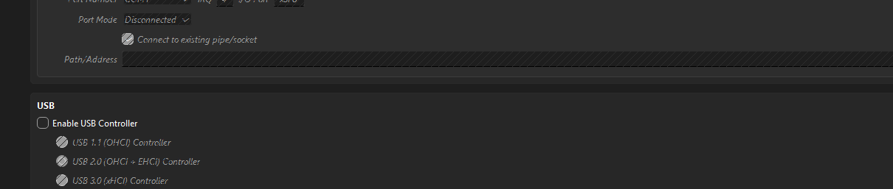

# Sprint 15 — Local Ubuntu Server Lab: VM Setup and Security Baseline

> **Project:** `se_project_express` / `se_project_react`  
> **Local VM:** `TripleTen-Project15`  
> **Documentation status (October 23, 2026):** VM created; Ubuntu installation **not yet verified**; pre-boot security audit in progress.

## 1. Purpose and deployment approach

TripleTen Sprint 15 covers automated testing and deployment. The course instructions include cloud-VM administration, but I cannot currently use cloud providers that require a payment card. I therefore chose two complementary environments:

1. **Local infrastructure lab:** An Ubuntu Server virtual machine in Oracle VirtualBox on my Windows 11 computer. I'll manually learn and document Linux administration, SSH, Node.js, Git, MongoDB connectivity, PM2, Nginx, and serving the backend and built frontend.
2. **Public deployment:** Render will host the publicly accessible application over HTTPS. The local VM will **not** be published on the internet.

Render was approved as an alternative for deployment, but I will separately confirm whether the local-VM exercises satisfy every VM-specific rubric item. Only `se_project_express` is submitted for review; the React repository supplies the frontend.

**Security boundary:** The VM uses NAT without inbound port-forwarding rules. This reduces unsolicited inbound exposure, but **does not mean the VM is fully isolated**: its outgoing traffic can still reach the internet and potentially the host or local network. Additional restrictions must be configured and tested separately.

## 2. Host environment and prerequisites

| Item | Observed value | Verification |
|---|---|---|
| Terminal | PowerShell 7.6.7 | Terminal session |
| Host OS | Windows 11 Home, build 26200 | `Win32_OperatingSystem` |
| Processor | AMD Ryzen 9 9900X, 12 cores | `Win32_Processor` |
| Firmware virtualization | Enabled | `VirtualizationFirmwareEnabled=True` |
| Microsoft Defender antivirus | Enabled | `Get-MpComputerStatus` |
| Microsoft Defender real-time protection | Enabled | `Get-MpComputerStatus` |
| Hypervisor | Oracle VirtualBox 7.2.22 | Installed application |
| Intended guest OS | Ubuntu Server 24.04 LTS | Attached Ubuntu 24.04.5 ISO |

### Commands and what they test

Run these **read-only** commands in PowerShell:

```powershell
Get-ComputerInfo |
  Select-Object WindowsProductName, WindowsVersion, OsBuildNumber

Get-CimInstance Win32_Processor |
  Select-Object Name, VirtualizationFirmwareEnabled

Get-MpComputerStatus |
  Select-Object AntivirusEnabled, RealTimeProtectionEnabled

Get-CimInstance Win32_OperatingSystem |
  Select-Object Caption, Version, BuildNumber
```

- `Get-ComputerInfo` returns Windows inventory information; `Select-Object` narrows the output to relevant properties.
- `Get-CimInstance Win32_Processor` asks Windows Management Instrumentation/CIM for CPU details and whether virtualization is enabled in firmware.
- `Get-MpComputerStatus` checks Microsoft Defender's reported antivirus and real-time protection states. An enabled antivirus **does not** prove the host has no vulnerabilities.
- `Get-CimInstance Win32_OperatingSystem` identifies the running OS and build.
- The `|` operator is a PowerShell pipeline: it sends objects or output from the left-hand command to the command on the right.

### Troubleshooting: misleading Windows version

The first command returned `Windows 10 Home` with build `26200`. I cross-checked with `Win32_OperatingSystem`, which explicitly reported `Microsoft Windows 11 Home`, version `10.0.26200`, build `26200`.

**Lesson learned:** When operating-system metadata conflicts, verify through another source before choosing a platform-dependent tool. The internal NT version prefix `10.0` does not itself mean the installed OS is Windows 10.

## 3. Choosing the virtualization platform

I evaluated Hyper-V and VirtualBox. Windows 11 Home does not include the full Hyper-V management role available on supported Pro/Enterprise/Education installations, so I chose VirtualBox. It supports Ubuntu guests, offers GUI and command-line management, and lets me practice network and device isolation.

A **hypervisor** creates and operates virtual computers on a physical host. A VM has its own virtual CPU, RAM, firmware, storage, and network adapter, but still depends on the security of its host and hypervisor.

### VirtualBox installation choices

Download: https://www.virtualbox.org/wiki/Downloads

I installed VirtualBox 7.2.22 with this reduced component set:

| Installer component | Selection | Reason |
|---|---|---|
| VirtualBox Application | Enabled | Required hypervisor and manager |
| USB Support | Disabled | No guest USB passthrough needed |
| Bridged Networking | Disabled | VM need not appear directly on the LAN |
| Host-Only Networking | Disabled initially | No separate host-to-guest management interface needed yet |
| Python Support | Disabled | Not needed for this manual exercise |


**Why minimize components?** Fewer enabled integrations mean fewer host/guest interfaces to configure, monitor, and secure. This is defense in depth, not proof that a VM cannot be compromised.

## 4. Selecting and verifying Ubuntu Server

I selected the **Ubuntu Server 24.04.5 LTS ISO** rather than Ubuntu Desktop or a short-lived interim Ubuntu release. The 24.04 LTS family is an established server environment, and MongoDB 8.0 Community Edition officially supports Ubuntu 24.04 LTS on 64-bit x86 systems.

- Ubuntu Server ISO: https://releases.ubuntu.com/24.04/
- Official checksum listing: https://releases.ubuntu.com/24.04/SHA256SUMS
- MongoDB Ubuntu 8.0 installation support: https://www.mongodb.com/docs/v8.0/tutorial/install-mongodb-on-ubuntu/

To calculate a checksum:

```powershell
Get-FileHash "$HOME\Downloads\ubuntu-24.04.5-live-server-amd64.iso" -Algorithm SHA256
```

Observed SHA-256 digest:

```text
97F3D7FFB032C3EB3B23D2C8BE9CC76E60C2C1F2C0146BA5BA9FE01CAFAE0FD8
```

I compared it with the entry for the same ISO filename in Ubuntu's official `SHA256SUMS` list and confirmed they matched.

**What this establishes:** File integrity relative to the checksum listing. Verifying the **cryptographic signature of the checksum file** would provide stronger assurance that the listing itself is authentic; that separate step has not been documented.

**MongoDB clarification:** A local command, `npm list mongoose`, previously reported **Mongoose 8.24.5** in the Express project. Mongoose is the Node.js database library, **not** the MongoDB server. This result does not establish which `mongod` version runs locally or will run in Ubuntu. The database version and connection strategy remain to be verified.

## 5. Creating the VM

The VM was created using the VirtualBox wizard and the verified Ubuntu installation ISO.

| VM setting | Selected value |
|---|---|
| Name | `TripleTen-Project15` |
| Memory | 4069 MB (approximately 4 GB) |
| Virtual CPUs | 2 |
| Virtual disk | 50 GB VDI |
| Firmware | EFI enabled |
| Guest installation media | `ubuntu-24.04.5-live-server-amd64.iso` |
| Network adapter 1 | NAT |
| Unattended installation | Disabled; manual installation intended |


**Important distinction:** VirtualBox currently labels the guest profile `Ubuntu 24.10 (Oracular Oriole) (64-bit)`, but the attached installer is **Ubuntu Server 24.04.5 LTS**. The guest-profile label is a VirtualBox setting and does **not** prove that Ubuntu 24.10 has been installed. We will verify the installed OS *inside Ubuntu* after installation.

EFI is enabled, but **Secure Boot has not been verified**. The VM was still powered off at the latest command-line inspection.

## 6. Security checkpoint: inspecting the VM before boot

### Read-only configuration query

```powershell
& "$env:ProgramFiles\Oracle\VirtualBox\VBoxManage.exe" showvminfo "TripleTen-Project15" --machinereadable |
  Select-String -Pattern '^(VMState|ostype|memory|cpus|firmware|nic[1-8]|natpf|nat-localhostreachable|usb|audio|clipboard|draganddrop|SharedFolder)'
```

- `&` invokes an executable located at a quoted path.
- `$env:ProgramFiles` references the Windows Program Files directory.
- `VBoxManage.exe showvminfo` reads the registered VM configuration without changing it.
- `--machinereadable` gives predictable `key=value` output.
- `Select-String -Pattern` filters lines matching the regular expression (`^` means the beginning of a line; `nic[1-8]` selects adapter lines 1–8).

Observed **saved** results:

```text
ostype="Ubuntu 24.10 (Oracular Oriole) (64-bit)"
memory=4069
firmware="EFI"
cpus=2
VMState="poweroff"
nic1="nat"
nic2="none"
nic3="none"
nic4="none"
nic5="none"
nic6="none"
nic7="none"
nic8="none"
audio="default"
audio_out="on"
audio_in="off"
clipboard="disabled"
clipboard_file_transfers="off"
draganddrop="disabled"
usb="on"
```

Other fields, including timestamps, are omitted here for readability; see the original terminal log for the complete filtered output.

### Network settings inspected through the GUI

- Adapter 1: **NAT**.
- Promiscuous Mode: **Deny**.
- Additional adapters: disabled in saved configuration.
- Port Forwarding: **empty rule table**.
- Shared folders: **none**.
- Clipboard and drag and drop: disabled in saved configuration.


**What the empty forwarding table means:** We haven't configured inbound NAT forwarding into the VM. This is appropriate for a private lab. **It does not block guest-originated outbound traffic**, and we haven't yet tested segmentation from the Windows host or LAN.

### USB and audio: changes not yet verified as saved

The last saved command output reported `usb="on"` and `audio_out="on"`. In a later VirtualBox settings screenshot, the **Enable USB Controller** checkbox was unchecked, but the GUI changes had not yet been confirmed by a new `VBoxManage` run. Audio was still enabled in an earlier screenshot.



I also observed an **“Invalid settings detected”** warning during configuration.


The exact cause is **not yet established**. A possible USB Tablet / disabled USB controller conflict was suggested as a hypothesis, not confirmed. We must inspect the warning message, resolve it, save the settings, and rerun the read-only query before concluding that the new configuration is applied.

## 7. Security checklist and actual status

| Check | Status as of this document | Why it matters |
|---|---|---|
| Host CPU virtualization supported | **Verified** | VM can use hardware virtualization |
| Windows 11 edition confirmed | **Verified** | Determines available virtualization options |
| Defender and real-time protection enabled | **Verified as reported** | Baseline host protection |
| Ubuntu ISO hash matches checksum listing | **Verified by comparison** | Installer integrity |
| VM created with disk, CPU, and RAM | **Verified** | Ready for configuration/installation |
| Adapter 1 uses NAT; adapters 2–8 off | **Verified (saved)** | Limits ordinary unsolicited inbound access |
| NAT port-forwarding table empty | **Verified visually** | No explicit inbound port mappings |
| Shared folders and clipboard disabled | **Verified** | Reduces host/guest integrations |
| USB controller disabled | **Pending saved-state verification** | Reduce unnecessary passthrough |
| Audio disabled | **Pending** | Remove unnecessary virtual hardware |
| Invalid-settings warning resolved | **Pending** | Prevent misconfiguration |
| Windows fully updated | **Not yet verified** | Host security maintenance |
| LAN / host outbound isolation | **Not yet configured or tested** | NAT permits VM-originated access |
| Guest installed and updated | **Not yet verified** | OS hardening prerequisite |
| Secure Boot status | **Not yet verified** | Firmware security feature |
| VM backup or restore test | **Not yet done** | Recovery capability |
| VM is publicly exposed | **No intended exposure; no forwarding configured** | Public access belongs on Render |

## 8. Next checkpoint — before booting Ubuntu

The next task is **not** to install application packages. First:

1. Determine the exact cause of the VirtualBox `Invalid settings detected` warning.
2. Resolve that specific configuration error without weakening Windows security features.
3. Save VirtualBox settings.
4. Rerun the `VBoxManage showvminfo` inspection and compare saved output against the intended configuration.
5. Record any remaining risks before starting the Ubuntu installer.

At this stage, do **not** add router forwarding or publish the local server. When Ubuntu is installed, we can separately design and test tighter outbound restrictions.

## 9. Sprint 15 requirements tracker

| Topic | Status |
|---|---|
| VM provisioning / local virtualization | **VM created; guest installation pending** |
| SSH access and administration | Not started |
| Git and Node.js on Ubuntu | Not started |
| MongoDB deployment/connectivity | Not started |
| PM2 process manager and restart exercise | Not started; **PM2 required for this exercise** |
| Nginx reverse proxy and static frontend | Not started |
| Backend/frontend end-to-end testing | Not started |
| Render public deployment over HTTPS | Not started |
| Temporary `/crash-test` review exercise | Not started; remove/restrict after controlled testing |
| Exact cloud-VM rubric equivalence | **Requires separate confirmation**; Render approval does not necessarily approve local VM substitution |

I will update this tracker after each verified checkpoint, rather than documenting planned configurations as completed work.

## 10. References

- [VirtualBox 7.2 security guidance](https://docs.oracle.com/en/virtualization/virtualbox/7.2/user/Security.html)
- [VirtualBox 7.2 virtual networking](https://docs.oracle.com/en/virtualization/virtualbox/7.2/user/networkingdetails.html)
- [Ubuntu 24.04 installation images and SHA256 checksums](https://releases.ubuntu.com/24.04/)
- [MongoDB 8.0 installation on supported Ubuntu releases](https://www.mongodb.com/docs/v8.0/tutorial/install-mongodb-on-ubuntu/)
- [GitHub Markdown and relative image paths](https://docs.github.com/en/get-started/writing-on-github/getting-started-with-writing-and-formatting-on-github/basic-writing-and-formatting-syntax)

---

**Documentation rule:** Record exactly what was executed or observed, explain the reason for each setting, retain verification evidence, and keep unfinished work explicitly marked as unfinished. Never add credentials, `.env` contents, API keys, private SSH keys, or access tokens to the repository.
