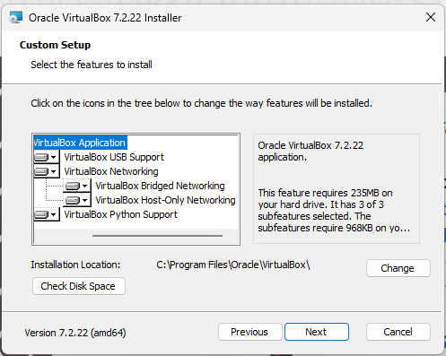
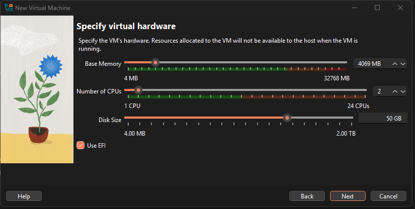
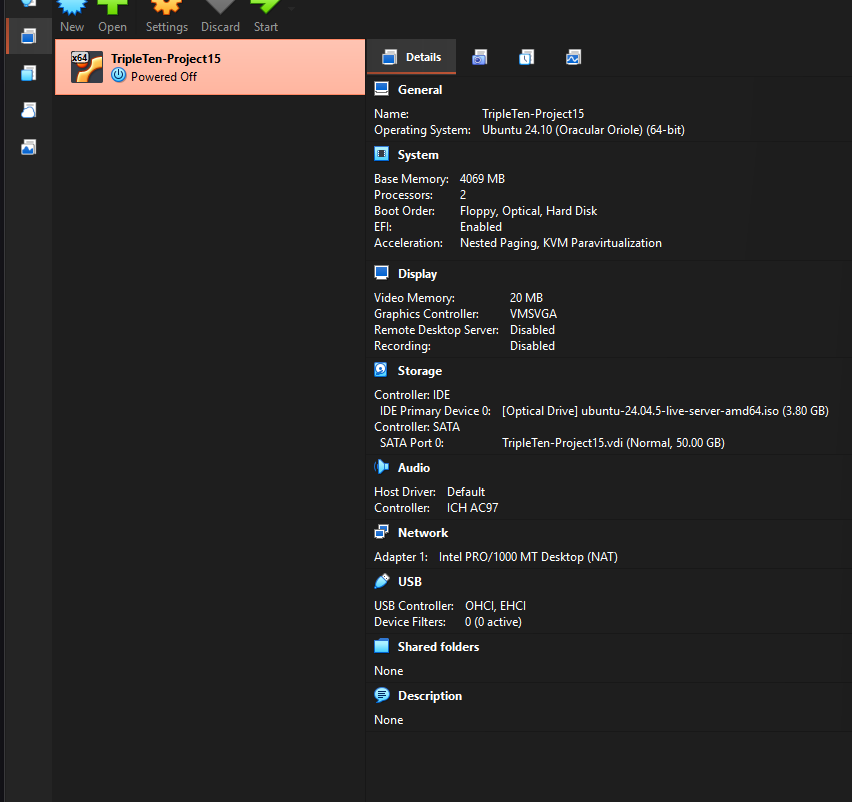
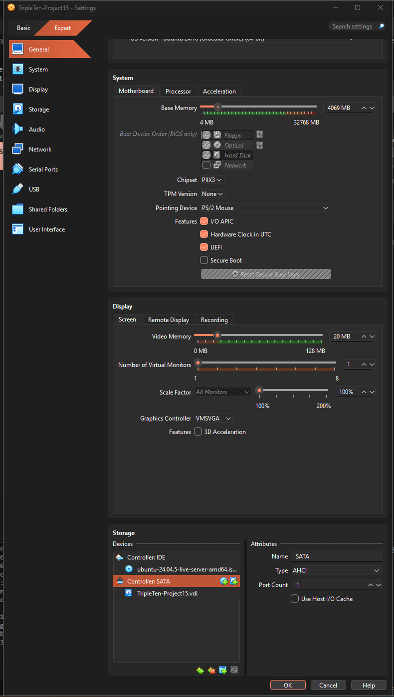
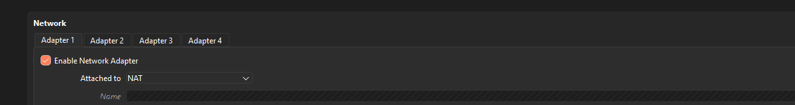
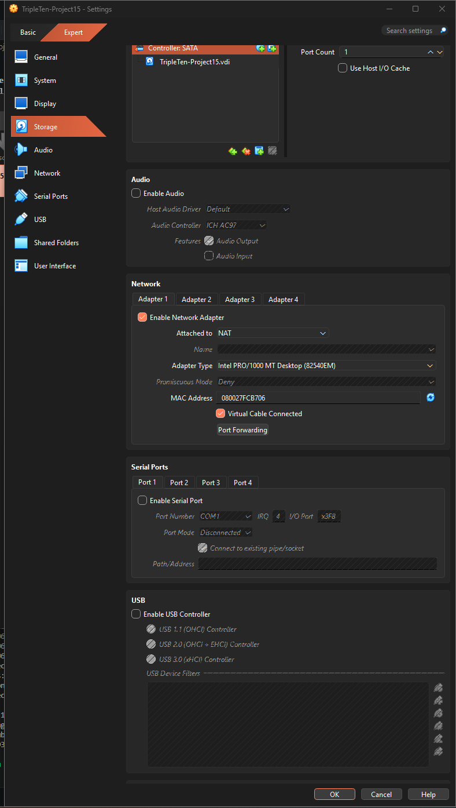
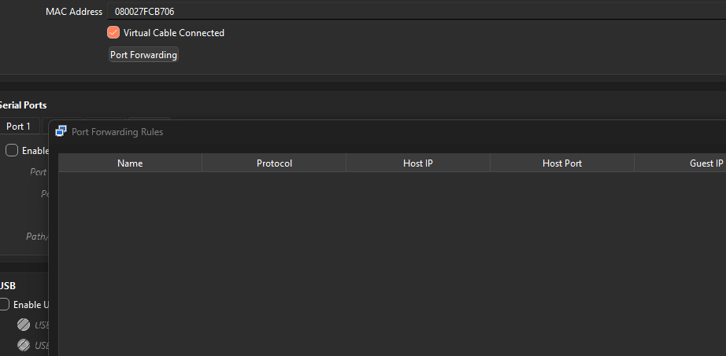
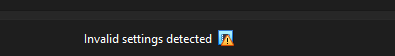
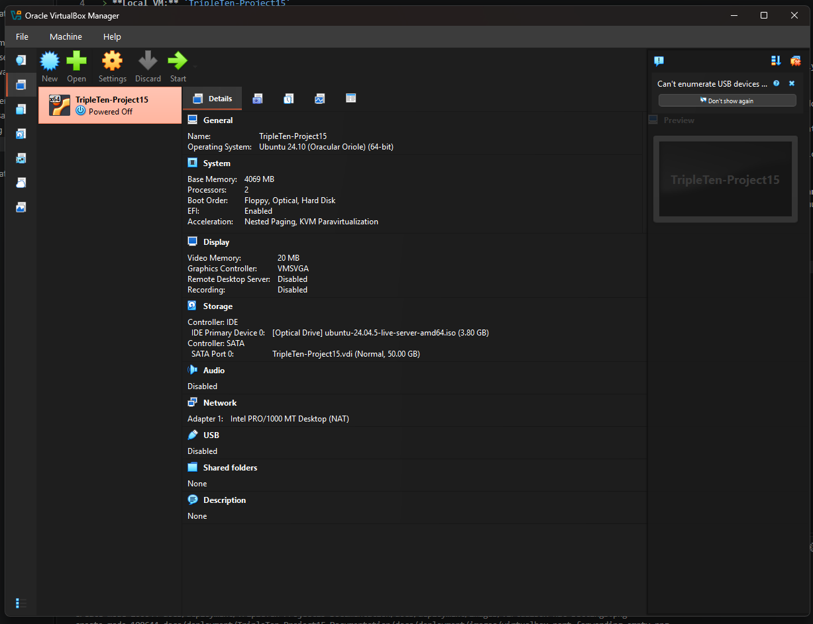
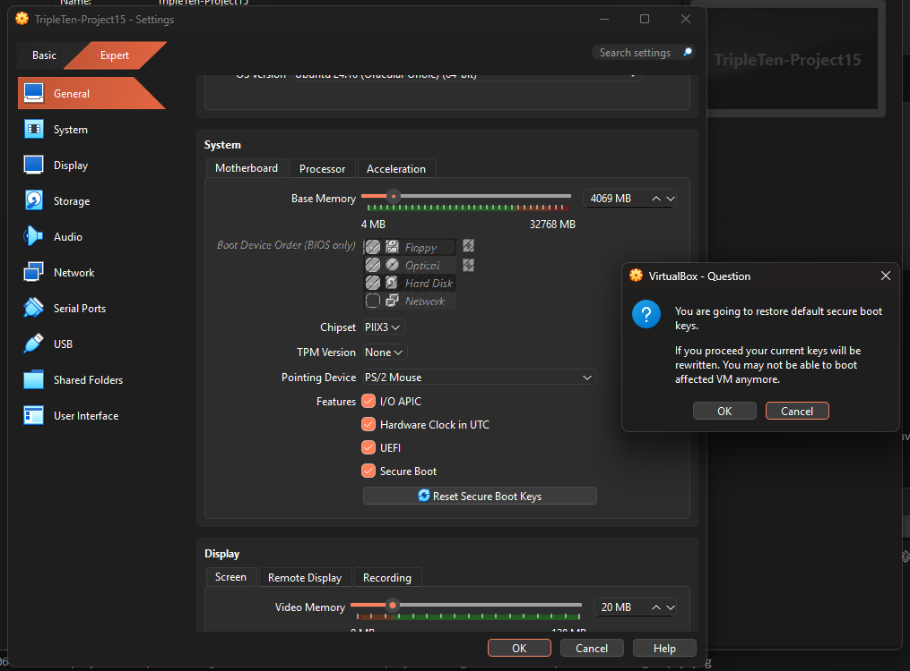

# Sprint 15 — Local Ubuntu Server Lab: VM Setup and Security Baseline

> **Project:** `se_project_express` / `se_project_react`  
> **Local VM:** `TripleTen-Project15`  
> **Documentation status (October 24, 2026):** VM created and powered off; virtual hardware hardening and NAT localhost restriction verified in the saved configuration. Secure Boot was selected in the settings GUI, but key reset was **not confirmed**, and saved Secure Boot status/enforcement are **not yet verified**. Ubuntu installation and broader host/LAN isolation **remain pending**.

## 1. Purpose and deployment approach

TripleTen Sprint 15 covers automated testing and deployment. The course instructions include cloud-VM administration, but I cannot currently use cloud providers that require a payment card. I therefore chose two complementary environments:

1. **Local infrastructure lab:** An Ubuntu Server virtual machine in Oracle VirtualBox on my Windows 11 computer. I'll manually learn and document Linux administration, SSH, Node.js, Git, MongoDB connectivity, PM2, Nginx, and serving the backend and built frontend.
2. **Public deployment:** Render will host the publicly accessible application over HTTPS. The local VM will **not** be published on the internet.

Render was approved as an alternative for deployment, but I will separately confirm whether the local-VM exercises satisfy every VM-specific rubric item. Only `se_project_express` is submitted for review; the React repository supplies the frontend.

**Security boundary:** The VM uses NAT without inbound port-forwarding rules. This reduces unsolicited inbound exposure, but **does not mean the VM is fully isolated**: its outgoing traffic can still reach the internet and potentially the host or local network. Additional restrictions must be configured and tested separately.

## 2. Host environment and prerequisites

| Item | Observed value | Verification |
|---|---|---|
| Terminal | PowerShell 7.6.7 | Terminal session |
| Host OS | Windows 11 Home, build 26200 | `Win32_OperatingSystem` |
| Processor | AMD Ryzen 9 9900X, 12 cores | `Win32_Processor` |
| Firmware virtualization | Enabled | `VirtualizationFirmwareEnabled=True` |
| Microsoft Defender antivirus | Enabled | `Get-MpComputerStatus` |
| Microsoft Defender real-time protection | Enabled | `Get-MpComputerStatus` |
| Hypervisor | Oracle VirtualBox 7.2.22 | Installed application |
| Intended guest OS | Ubuntu Server 24.04 LTS | Attached Ubuntu 24.04.5 ISO |

### Commands and what they test

Run these **read-only** commands in PowerShell:

```powershell
Get-ComputerInfo |
  Select-Object WindowsProductName, WindowsVersion, OsBuildNumber

Get-CimInstance Win32_Processor |
  Select-Object Name, VirtualizationFirmwareEnabled

Get-MpComputerStatus |
  Select-Object AntivirusEnabled, RealTimeProtectionEnabled

Get-CimInstance Win32_OperatingSystem |
  Select-Object Caption, Version, BuildNumber
```

- `Get-ComputerInfo` returns Windows inventory information; `Select-Object` narrows the output to relevant properties.
- `Get-CimInstance Win32_Processor` asks Windows Management Instrumentation/CIM for CPU details and whether virtualization is enabled in firmware.
- `Get-MpComputerStatus` checks Microsoft Defender's reported antivirus and real-time protection states. An enabled antivirus **does not** prove the host has no vulnerabilities.
- `Get-CimInstance Win32_OperatingSystem` identifies the running OS and build.
- The `|` operator is a PowerShell pipeline: it sends objects or output from the left-hand command to the command on the right.

### Troubleshooting: misleading Windows version

The first command returned `Windows 10 Home` with build `26200`. I cross-checked with `Win32_OperatingSystem`, which explicitly reported `Microsoft Windows 11 Home`, version `10.0.26200`, build `26200`.

**Lesson learned:** When operating-system metadata conflicts, verify through another source before choosing a platform-dependent tool. The internal NT version prefix `10.0` does not itself mean the installed OS is Windows 10.

## 3. Choosing the virtualization platform

I evaluated Hyper-V and VirtualBox. Windows 11 Home does not include the full Hyper-V management role available on supported Pro/Enterprise/Education installations, so I chose VirtualBox. It supports Ubuntu guests, offers GUI and command-line management, and lets me practice network and device isolation.

A **hypervisor** creates and operates virtual computers on a physical host. A VM has its own virtual CPU, RAM, firmware, storage, and network adapter, but still depends on the security of its host and hypervisor.

### VirtualBox installation choices

Download: https://www.virtualbox.org/wiki/Downloads

I installed VirtualBox 7.2.22 with this reduced component set:

| Installer component | Selection | Reason |
|---|---|---|
| VirtualBox Application | Enabled | Required hypervisor and manager |
| USB Support | Disabled | No guest USB passthrough needed |
| Bridged Networking | Disabled | VM need not appear directly on the LAN |
| Host-Only Networking | Disabled initially | No separate host-to-guest management interface needed yet |
| Python Support | Disabled | Not needed for this manual exercise |



**Why minimize components?** Fewer enabled integrations mean fewer host/guest interfaces to configure, monitor, and secure. This is defense in depth, not proof that a VM cannot be compromised.

## 4. Selecting and verifying Ubuntu Server

I selected the **Ubuntu Server 24.04.5 LTS ISO** rather than Ubuntu Desktop or a short-lived interim Ubuntu release. The 24.04 LTS family is an established server environment, and MongoDB 8.0 Community Edition officially supports Ubuntu 24.04 LTS on 64-bit x86 systems.

- Ubuntu Server ISO: https://releases.ubuntu.com/24.04/
- Official checksum listing: https://releases.ubuntu.com/24.04/SHA256SUMS
- MongoDB Ubuntu 8.0 installation support: https://www.mongodb.com/docs/v8.0/tutorial/install-mongodb-on-ubuntu/

To calculate a checksum:

```powershell
Get-FileHash "$HOME\Downloads\ubuntu-24.04.5-live-server-amd64.iso" -Algorithm SHA256
```

Observed SHA-256 digest:

```text
97F3D7FFB032C3EB3B23D2C8BE9CC76E60C2C1F2C0146BA5BA9FE01CAFAE0FD8
```

I compared it with the entry for the same ISO filename in Ubuntu's official `SHA256SUMS` list and confirmed they matched.

**What this establishes:** File integrity relative to the checksum listing. Verifying the **cryptographic signature of the checksum file** would provide stronger assurance that the listing itself is authentic; that separate step has not been documented.

**MongoDB clarification:** A local command, `npm list mongoose`, previously reported **Mongoose 8.24.5** in the Express project. Mongoose is the Node.js database library, **not** the MongoDB server. This result does not establish which `mongod` version runs locally or will run in Ubuntu. The database version and connection strategy remain to be verified.

## 5. Creating the VM

The VM was created using the VirtualBox wizard and the verified Ubuntu installation ISO.

| VM setting | Selected value |
|---|---|
| Name | `TripleTen-Project15` |
| Memory | 4069 MB (approximately 4 GB) |
| Virtual CPUs | 2 |
| Virtual disk | 50 GB VDI |
| Firmware | EFI enabled |
| Guest installation media | `ubuntu-24.04.5-live-server-amd64.iso` |
| Network adapter 1 | NAT |
| Unattended installation | Disabled; manual installation intended |





**Important distinction:** VirtualBox currently labels the guest profile `Ubuntu 24.10 (Oracular Oriole) (64-bit)`, but the attached installer is **Ubuntu Server 24.04.5 LTS**. The guest-profile label is a VirtualBox setting and does **not** prove that Ubuntu 24.10 has been installed. We will verify the installed OS *inside Ubuntu* after installation.

EFI is enabled. In the earlier saved settings, **Secure Boot was disabled**, as shown in the system-settings screenshot. On October 24 I selected **Secure Boot** in the GUI, but have not yet verified whether the checkbox change was saved or whether signing keys are enrolled. EFI and Secure Boot are separate features. The VM remained powered off during our latest command-line inspections.



## 6. Security checkpoint: inspecting the VM before boot

### Read-only configuration query

```powershell
& "$env:ProgramFiles\Oracle\VirtualBox\VBoxManage.exe" showvminfo "TripleTen-Project15" --machinereadable |
  Select-String -Pattern '^(VMState|ostype|memory|cpus|firmware|nic[1-8]|natpf|nat-localhostreachable|usb|audio|clipboard|draganddrop|SharedFolder)'
```

- `&` invokes an executable located at a quoted path.
- `$env:ProgramFiles` references the Windows Program Files directory.
- `VBoxManage.exe showvminfo` reads the registered VM configuration without changing it.
- `--machinereadable` gives predictable `key=value` output.
- `Select-String -Pattern` filters lines matching the regular expression (`^` means the beginning of a line; `nic[1-8]` selects adapter lines 1–8).

Observed **initial saved baseline** (before the later hardware-hardening changes):

```text
ostype="Ubuntu 24.10 (Oracular Oriole) (64-bit)"
memory=4069
firmware="EFI"
cpus=2
VMState="poweroff"
nic1="nat"
nic2="none"
nic3="none"
nic4="none"
nic5="none"
nic6="none"
nic7="none"
nic8="none"
audio="default"
audio_out="on"
audio_in="off"
clipboard="disabled"
clipboard_file_transfers="off"
draganddrop="disabled"
usb="on"
```

Other fields, including timestamps, are omitted for readability. The initial `usb="on"` and `audio="default"` values were **historical**; subsequent saved-state verification below confirms that both devices were disabled.

### Network settings inspected through the GUI

- Adapter 1: **NAT**.
- Promiscuous Mode: **Deny**.
- Additional adapters: disabled in saved configuration.
- Port Forwarding: **empty rule table**.
- Shared folders: **none**.
- Clipboard and drag and drop: disabled in saved configuration.







**What the empty forwarding table means:** We haven't configured inbound NAT forwarding into the VM. This is appropriate for a private lab. **It does not block guest-originated outbound traffic**, and we haven't yet tested segmentation from the Windows host or LAN.

### Restricting NAT access to Windows localhost

VirtualBox NAT allows the future Ubuntu guest to initiate outbound connections while normally preventing unsolicited inbound connections without a forwarding rule. NAT **does not** fully isolate the guest from the Windows host or LAN.

To restrict the special path through which a NAT guest can access host services bound to the Windows loopback interface (`127.0.0.1`), I disabled NAT adapter 1's localhost reachability.

**Configuration command:**

```powershell
& "$env:ProgramFiles\Oracle\VirtualBox\VBoxManage.exe" modifyvm "TripleTen-Project15" --nat-localhostreachable1 off
```

The command completed without reporting an error.

**Verification command:**

```powershell
& "$env:ProgramFiles\Oracle\VirtualBox\VBoxManage.exe" showvminfo "TripleTen-Project15" --machinereadable |
  Select-String -Pattern 'localhost|nat|VMState'
```

**Observed output:**

```text
VMState="poweroff"
natnet1="nat"
nic1="nat"
localhostReachable="0"
```

**Explanation:**

- `modifyvm` changes the saved configuration of an existing VM.
- `--nat-localhostreachable1 off` disables NAT adapter 1's special reachability to host-loopback services (through VirtualBox's host-side NAT interface).
- `showvminfo` reads the saved VM configuration without modifying it.
- `localhostReachable="0"` confirms the setting is disabled in the VM configuration.

**Security limitations:**

This is a **configuration check, not a guest-network penetration test**. It restricts one host-loopback pathway but does not prevent other guest-originated connections to the Windows host, other LAN devices, or the internet. Broader segmentation and guest-side testing remain outstanding.

Reference:
https://docs.oracle.com/en/virtualization/virtualbox/7.2/user/vboxmanage.html

### Virtual hardware hardening — verified

During the initial configuration, VirtualBox displayed an **"Invalid settings detected"** warning. The VM had been configured to use a USB Tablet pointing device while I was disabling the USB controller. This looked like a possible mismatch, but the precise cause of the warning was not captured.

I changed the pointing device to **PS/2 Mouse**, disabled virtual audio and USB, and saved the settings. The warning was no longer visible. I then repeated the PowerShell inspection to confirm the saved values rather than relying only on GUI checkboxes.



```powershell
& "$env:ProgramFiles\Oracle\VirtualBox\VBoxManage.exe" showvminfo "TripleTen-Project15" --machinereadable |
  Select-String -Pattern '^(VMState|hidpointing|usb|audio|nic[1-8]|natpf|clipboard|draganddrop)'
```

Key results:

```text
VMState="poweroff"
nic1="nat"
nic2="none"
hidpointing="ps2mouse"
audio="none"
clipboard="disabled"
draganddrop="disabled"
usb="off"
```

**Why these changes matter:**

- Disabling USB eliminates unnecessary virtual USB devices.
- Disabling audio removes an unused virtual hardware component.
- PS/2 Mouse avoids the need for a USB pointing device.
- Disabled clipboard and drag-and-drop reduce host/guest integration.
- No NAT port-forwarding rules are configured.

The invalid-settings warning was no longer displayed after these changes, but the suspected USB Tablet conflict was **not independently confirmed** as the original cause. The saved `audio="none"` value means the virtual audio device is disabled, even though VirtualBox may retain an `audio_out` preference field.



**Remaining limitations:** Secure Boot is selected in the GUI but not verified as saved or enforcing; the VM has not yet been booted; and outbound host/LAN isolation is not yet fully implemented or tested.

### Secure Boot selection and key-reset warning — pending verification

I opened **Settings → System → Motherboard** and selected the **Secure Boot** checkbox while the VM was powered off. The checkbox appeared checked in the GUI.

I then opened **Reset Secure Boot Keys**, which displayed a confirmation warning that continuing would overwrite the VM's current Secure Boot keys and might prevent an affected guest from booting. **The screenshot records the confirmation prompt, not a completed key reset.** I have not confirmed overwriting keys, saved-state verification, or boot enforcement in this documentation.



**Why Secure Boot matters:** UEFI firmware starts the guest operating system; Secure Boot adds signature validation against trusted firmware keys for components in the boot chain. Ubuntu Server 24.04 LTS supports UEFI Secure Boot, but enabling a GUI checkbox alone does not prove that the necessary keys are enrolled or that verification is enforced.

**Current decision:** Cancel the key-reset confirmation for now. Before performing a key reset, inspect the remaining Secure Boot options and saved state. Since this VM has no installed guest OS yet, a future documented decision to enroll default certificates can be evaluated without risking an existing Ubuntu installation. Only mark Secure Boot **verified** after checking the final firmware configuration and, once Ubuntu is installed, confirming that it boots and reports Secure Boot enabled.

**Verification still needed:**

1. Close the reset confirmation without overwriting keys; save only the intended, valid settings.
2. Inspect the saved VirtualBox Secure Boot configuration, including whether trusted keys are present.
3. After installing Ubuntu, verify Secure Boot from inside the guest (for example, using `mokutil --sb-state` if available), and capture the actual result.

References:
- https://docs.oracle.com/en/virtualization/virtualbox/7.2/user/working-with-vms.html
- https://documentation.ubuntu.com/security/security-features/platform-protections/secure-boot/

#### Verifying the saved Secure Boot configuration

After enabling Secure Boot through the VirtualBox GUI,
I inspected the VM configuration using PowerShell.

```powershell
& "$env:ProgramFiles\Oracle\VirtualBox\VBoxManage.exe" showvminfo "TripleTen-Project15" --machinereadable |
  Select-String -Pattern 'secure|efi|firmware|VMState'
```

The first inspection occurred while VirtualBox Settings
was still open and returned only the EFI firmware setting.

After clicking OK to save and close Settings, I repeated
the same command.

Verified output:

```text
firmware="EFI"
SecureBoot="on"
VMState="poweroff"
```

**Result:** Secure Boot is enabled in the saved VM
configuration.

**Lesson learned:** GUI changes should be independently
verified after saving. An unsaved setting can appear enabled
in the interface without being reflected in the VM's
persistent configuration.

**Remaining verification:** Secure Boot key enrollment and
boot-time signature enforcement have not yet been confirmed.

### Offline first-boot preparation

Before starting Ubuntu, I disconnected the VM's virtual
Ethernet cable while keeping the adapter configured as NAT.

This prevents ordinary network communication during the
initial boot and Secure Boot inspection.

I disabled "Virtual Cable Connected" under:
VirtualBox → Settings → Network → Adapter 1.

**Verification command:**

```powershell
& "$env:ProgramFiles\Oracle\VirtualBox\VBoxManage.exe" showvminfo "TripleTen-Project15" --machinereadable |
  Select-String -Pattern 'VMState|nic1|cableconnected1|SecureBoot|firmware'
```

**Verified output:**

```text
firmware="EFI"
SecureBoot="on"
VMState="poweroff"
cableconnected1="off"
nic1="nat"
```

**Result:** The saved configuration enables Secure Boot
and disconnects the VM's only enabled network adapter.

Secure Boot key enrollment and actual boot enforcement
still require verification.

## 7. Security checklist and actual status

| Check | Status as of October 24, 2026 | Evidence or limitation |
|---|---|---|
| Host CPU virtualization enabled | **Verified** | `VirtualizationFirmwareEnabled=True` |
| Windows 11 Home identified | **Verified** | `Win32_OperatingSystem` returned build 26200 |
| Microsoft Defender and real-time protection enabled | **Verified as reported** | Does not prove the host is fully patched or secure |
| Ubuntu ISO hash matches Ubuntu checksum listing | **Verified by comparison** | Signed-checksum verification not separately documented |
| VM provisioned (disk, CPUs, RAM, EFI) | **Verified** | VirtualBox Manager and saved configuration |
| Adapter 1 uses NAT; adapters 2–8 disabled | **Verified (saved)** | `VBoxManage showvminfo` |
| NAT port forwarding has no rules | **Verified visually** | No configured inbound guest port maps |
| NAT localhost reachability disabled | **Verified (saved)** | `localhostReachable="0"` |
| Promiscuous mode set to Deny | **Verified visually** | Network settings screenshot |
| Shared folders absent | **Verified visually** | VirtualBox Manager/settings |
| Clipboard and drag-and-drop disabled | **Verified (saved)** | `clipboard="disabled"`, `draganddrop="disabled"` |
| USB controller disabled | **Verified (saved)** | `usb="off"` |
| Audio device disabled | **Verified (saved)** | `audio="none"` |
| Pointing device changed to PS/2 Mouse | **Verified (saved)** | `hidpointing="ps2mouse"` |
| Previous invalid-settings warning | **No longer observed** | Original cause not independently established |
| EFI enabled | **Verified (saved)** | `firmware="EFI"` |
| Secure Boot | **Enabled** | Enabled in saved configuration; key enrollment and enforcement pending |
| Default Secure Boot key reset | **Not confirmed** | Warning dialog was displayed; completion not established |
| Windows fully updated | **Not yet checked** | Patch/host maintenance review required |
| Broader host/LAN isolation | **Not configured/tested** | NAT and localhost restriction alone are insufficient |
| Ubuntu installed, bootable, and updated | **Not yet verified** | Installation not yet undertaken in this record |
| Backup/snapshot and restoration | **Not yet done** | Recovery plan required |
| Public exposure of the local VM | **No intended exposure** | No port forwarding configured; external reachability not independently tested |

## 8. Next checkpoint — Ubuntu first-boot preparation

The pre-boot VirtualBox device-hardening and localhost-reachability configuration checks are complete. **Do not yet mark network isolation complete.** Before the first Ubuntu installation boot, the next checkpoint is to:

1. Resolve the **UEFI Secure Boot** configuration deliberately: cancel the currently open key-reset confirmation, verify the saved checkbox setting and key configuration, and document any decision to enroll default keys before boot. The GUI checkbox alone does not establish enforcement.
2. Review how to restrict the VM's **outbound access to the Windows host and private LAN**, while still allowing necessary Ubuntu package downloads. NAT by itself is not adequate segmentation.
3. Confirm the host's update and firewall baseline and document any remaining risks.
4. Boot the verified Ubuntu Server 24.04.5 installer and record the actual guest installation results. Do not document Ubuntu as installed until that has been verified inside the guest.
5. Create a clean recovery snapshot or backup at an appropriate completed state and verify the recovery procedure.

**Operational rule:** Use the VirtualBox console for initial administration, keep all NAT port-forwarding rules empty, and do not forward router ports or publish this local VM. The public app will be deployed separately through Render.

### Documentation evidence to capture next

- Screenshot of the Secure Boot checkbox and pending reset-key warning (`images/virtualbox-secure-boot-key-reset-confirmation.png`), explicitly labeled **not evidence of completed key enrollment**.
- Screenshot of final firmware/security settings after any later confirmed changes.
- PowerShell commands and **actual output** verifying final saved settings.
- Ubuntu installer screens showing OS selection and configuration (omit passwords, credentials, and any secrets).
- Guest terminal output verifying installed OS release *after* installation.

## 9. Sprint 15 requirements tracker

| Topic | Status |
|---|---|
| VM provisioning / local virtualization | **VM created and pre-boot configuration verified; guest installation pending** |
| SSH access and administration | Not started |
| Git and Node.js on Ubuntu | Not started |
| MongoDB deployment/connectivity | Not started |
| PM2 process manager and restart exercise | Not started; **PM2 required for this exercise** |
| Nginx reverse proxy and static frontend | Not started |
| Backend/frontend end-to-end testing | Not started |
| Render public deployment over HTTPS | Not started |
| Temporary `/crash-test` review exercise | Not started; remove/restrict after controlled testing |
| Exact cloud-VM rubric equivalence | **Requires separate confirmation**; Render approval does not necessarily approve local VM substitution |

I will update this tracker after each verified checkpoint, rather than documenting planned configurations as completed work.

## 10. References

- [VirtualBox 7.2 security guidance](https://docs.oracle.com/en/virtualization/virtualbox/7.2/user/Security.html)
- [VirtualBox 7.2 virtual networking](https://docs.oracle.com/en/virtualization/virtualbox/7.2/user/networkingdetails.html)
- [VirtualBox VBoxManage reference](https://docs.oracle.com/en/virtualization/virtualbox/7.2/user/vboxmanage.html)
- [VirtualBox VM configuration and Secure Boot](https://docs.oracle.com/en/virtualization/virtualbox/7.2/user/working-with-vms.html)
- [Ubuntu Secure Boot documentation](https://documentation.ubuntu.com/security/security-features/platform-protections/secure-boot/)
- [Ubuntu 24.04 installation images and SHA256 checksums](https://releases.ubuntu.com/24.04/)
- [MongoDB 8.0 installation on supported Ubuntu releases](https://www.mongodb.com/docs/v8.0/tutorial/install-mongodb-on-ubuntu/)
- [GitHub Markdown and relative image paths](https://docs.github.com/en/get-started/writing-on-github/getting-started-with-writing-and-formatting-on-github/basic-writing-and-formatting-syntax)

---

**Documentation rule:** Record exactly what was executed or observed, explain the reason for each setting, retain verification evidence, and keep unfinished work explicitly marked as unfinished. Never add credentials, `.env` contents, API keys, private SSH keys, or access tokens to the repository.

**Screenshot rule:** Images referenced as `images/<filename>.png` must exist alongside this file under `docs/deployment/images/`. Verify them in VS Code Markdown Preview (`Ctrl+Shift+V`) before committing. The Markdown references do not establish that the underlying PNGs are present.