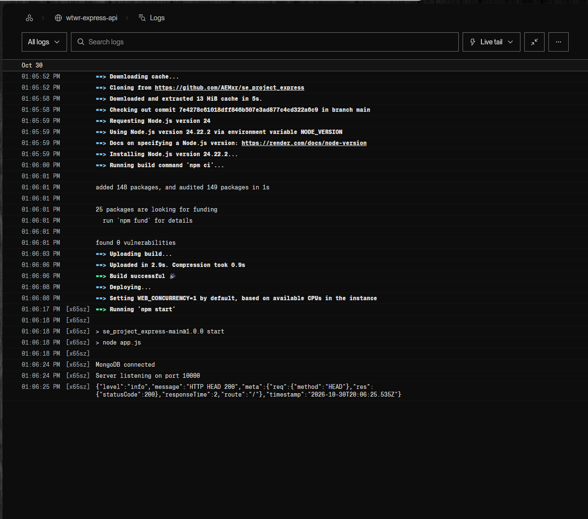
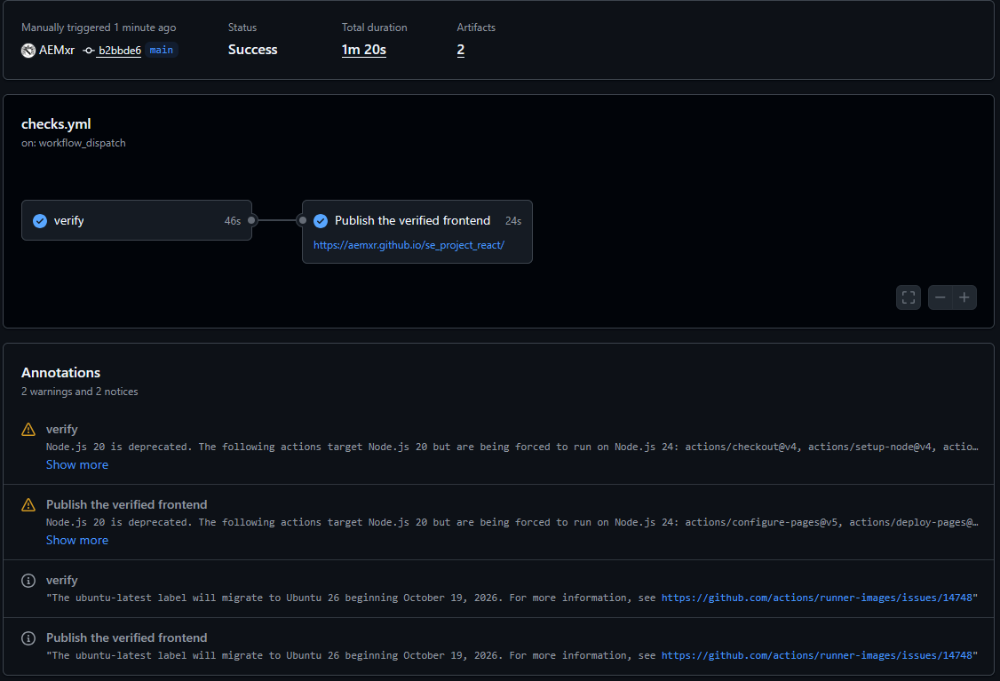

# Sprint 15 — WTWR Cloud Deployment and End-to-End Validation

> **Deployment verified:** October 30, 2026 · **Documented:** October 31, 2026  
> **Back-end repo:** `AEMxr/se_project_express` (`main`, deployed commit `7e4278c`)  
> **Front-end repo:** `AEMxr/se_project_react` (`main`, deployed commit `b2bbde6`)  
> **Scope:** Observed cloud configuration and validation, excluding any credentials. URLs shown here are public application addresses; **never publish private connection strings**.

## 1. Architecture and choices

```text
Browser
   |
   | HTTPS
   v
GitHub Pages (React/Vite)
https://aemxr.github.io/se_project_react/
   |
   | HTTPS API requests
   v
Render web service (Express 5 / Node 24)
https://wtwr-express-api.onrender.com
   |
   | TLS MongoDB connection, database-scoped account
   v
MongoDB Atlas: tripleten cluster -> wtwr_render
```

The VM from [02 — Ubuntu operations](../virtualbox/02-ubuntu-operations.md) is **not** part of the public traffic path. React static assets are hosted on GitHub Pages, the Node API on Render, and persistent application data in Atlas. The Render free service can spin down while idle; the frontend's 15-second request timeout caused transient errors while the backend was waking up. This is a known course-demo tradeoff, not a reason to put the user's Windows computer online.

**Alternative approved by course:** Render was allowed instead of a Google Cloud VM for public deployment. This approval does not independently establish that every VM-specific rubric item is satisfied.

## 2. Database source discovery and data isolation

Initial inventory (from Atlas UI and Windows read-only MongoDB counts):

| Database source | Users | Clothing items | Additional data |
|---|---:|---:|---|
| Existing Atlas `wtwr_db` | 5 | 12 | `sample_mflix` also present in cluster |
| Windows local `wtwr_db` | 3 | 2 | GridFS collections: `garmentPhotos.files` (1), `.chunks` (2) |
| New Atlas `wtwr_render` | Empty initially | Empty initially | Subsequently received a new test user and clothing items through the live site |

Those preexisting databases were **not merged or overwritten**. No backup or replication between Atlas and Windows was established. GridFS chunk counts do not equal photo counts.

A new Atlas database user `wtwr_render_app` was created using password-based SCRAM authentication with **only `readWrite@wtwr_render`**. Earlier, Atlas had a separate `atlasAdmin@admin` user; its administrative credential was not used by Render. Atlas UI's “All Resources” describes the cluster-resource scope and does not override the database-specific role's privileges.

> **Unresolved security item:** The `wtwr_render_app` password was displayed in a prior screenshot/chat and the user elected not to rotate it at that time. Treat it as **exposed** and rotate before treating the service as a secure production deployment. Do not copy the leaked secret to documentation, issue logs, screenshots or Git history.

## 3. Atlas network access

The Atlas project's original public IPv4 `/32` rule was kept unchanged (not reproduced here). Two Render Oregon outbound CIDR ranges were added:

```text
74.220.48.0/24
74.220.56.0/24
```

They were obtained from **Render web service → Connect → Outbound**. These ranges are **shared across services in the region**, not unique source addresses for this application. Network allowlisting reduces exposure but does not replace database authentication or least privilege. No `0.0.0.0/0` rule was requested.

## 4. Render Express service

| Setting | Configured value |
|---|---|
| Service name | `wtwr-express-api` |
| Service type | Web Service, Node.js |
| Plan | Free (at the time of configuration) |
| Region | Oregon (US West) |
| GitHub source | `AEMxr/se_project_express`, branch `main` |
| Root directory | Repository root (blank option) |
| Build command | `npm ci` |
| Start command | `npm start` (runs `node app.js`) |
| Health check path | `/` (existing route; `/healthz` was not implemented) |
| Node version | `NODE_VERSION=24` (Render logs: Node `24.22.2`) |
| Port | `PORT=10000` |
| Environment mode | `NODE_ENV=production` |
| JWT signing secret | Unique Render-generated `JWT_SECRET` (different from Windows and VM) |
| MongoDB URI | Secret `MONGODB_URI` pointing at `wtwr_render` through restricted Atlas user |
| Weather API | Backend-only OpenWeather API configuration; working weather observed later in browser |

**Sanitized MongoDB URI shape** (not a valid literal credential):

```text
mongodb+srv://wtwr_render_app:<URL_ENCODED_PASSWORD>@<ATLAS_HOST>/wtwr_render?authSource=admin
```

The actual username/password/host reside only in the Render environment and credential manager, never in Git. `authSource=admin` is an **authentication database** selector, not a grant of administrator privileges. URL-encode reserved characters in a password.

### Initial failure 1 — Atlas blocked network origin

The first build succeeded and `npm start` ran, but the application exited because it could not connect to Atlas. At the time, Atlas allowed only the earlier local public `/32`. Adding **both** Render outbound ranges fixed network reachability. This was not a problem with Express code or Node packages.

### Initial failure 2 — Application database omitted

After the network fix, the server connected, but `GET /items` returned HTTP 500 with `MongoServerError`. The MongoDB URI ended at the host's final `/` and did **not** specify `wtwr_render`. The server therefore tried an unintended default database for which the restricted user lacked permission. Adding `/wtwr_render?authSource=admin` resolved the authorization mismatch. Do not broaden user permissions to work around an incorrect database path.

### Verified server outcome

The successful Render deployment logs showed:

```text
Build successful
Running 'npm start'
MongoDB connected
Server listening on port 10000
HTTP HEAD 200 (health path /)
```

**Screenshot, with secrets excluded:**



A public browser request to `/` returned `{ "status": "ok" }`. The first valid `/items` request returned `[]` while the deployment database was empty. A later command-line test explicitly returned `HTTP/1.1 200 OK` with `content-type: application/json` and body `[]`. Unmatched routes occasionally returned 404; those were separate requests, not contradictions. An HTTP 304 for `/items` indicated browser cache reuse, not an application failure.

**Build dependencies:** Render reported `0 vulnerabilities` during its `npm ci` production build at that time. Earlier development-machine audits had findings in dev dependencies; see [02](../virtualbox/02-ubuntu-operations.md).

## 5. GitHub Pages React frontend

| Setting | Value |
|---|---|
| Repo | `AEMxr/se_project_react` |
| Git ref deployed | `b2bbde6` |
| Framework / build tool | React 19 / Vite 6 |
| Pages publishing mode | GitHub Actions |
| Pages URL | https://aemxr.github.io/se_project_react/ |
| GitHub Actions repository **variable** | `VITE_API_BASE_URL` = `https://wtwr-express-api.onrender.com` |
| Backend CORS | The `https://aemxr.github.io` origin was authorized in the backend configuration inspected during setup |

The existing `.github/workflows/checks.yml` performed lint, formatting checks, regression and Jest coverage checks, client-build security tests, production build, artifact upload, and GitHub Pages deployment. The final manual run reported success for **both** the `verify` and `Publish the verified frontend` jobs (total 1m20s).



The Vite production build uses a `/se_project_react/` base and `HashRouter`. The public API base URL is intentionally compiled into frontend assets and must contain **no credentials**. Its default for local development is `http://localhost:3001`.

**CI maintenance notice:** GitHub Actions emitted Node 20 *action-runtime* deprecation warnings and notice about `ubuntu-latest` moving to a newer image. Existing verify and publish jobs **passed**. Workflow currently tests Node 22 whereas the deployed runtime is Node 24; review upgrading / testing a version matrix when appropriate.

## 6. End-to-end browser evidence

| Check | Observed result |
|---|---|
| Open public React page | WTWR styled page loads in Chrome and Firefox |
| Public backend root | Status `{ "status": "ok" }` |
| Cloud item list, initially empty | `GET /items` → HTTP 200 and JSON `[]` |
| Register account | Registration succeeded; authenticated profile appeared |
| Atlas user existence | User record found in `wtwr_render.users` via Data Explorer |
| Profile avatar | Initially fallback initial displayed; subsequently working image displayed |
| Create clothing item | Clothing item appeared in user profile and in Atlas |
| Refresh webpage | User remained logged in and clothing item remained present |
| Weather | Later screenshot showed **Vancouver, 55°F** with clothing recommendation; initial “weather unavailable” resolved |

These prove key **happy-path integrations** from browser to API to database and back. They do not prove every authorization case, recovery behavior, or load requirement.

### Timeout / 404 observations

The first public frontend load showed **weather and clothing request timeouts**. After opening the backend root URL to awaken the free Render service, **Retry clothing** succeeded and the error disappeared. This supports (but does not mathematically prove) the free-instance cold-start/15-second frontend timeout explanation.

Some Render logs showed 404 `NotFoundError` with route `(unmatched)`. The requested path was not logged; this might have been a favicon request or another undefined URL. Do not label it a backend database failure without identifying the path.

Weather errors persisted until the hosted weather integration was functional; the later real UI snapshot reported weather and recommendations. The precise production `OPEN_WEATHER_API_KEY` setting has not been independently inspected in this record. **Never include the key in frontend variables.**

## 7. Security and operations notes

- The original local JWT secret and Render JWT secret **should not match**. They sign tokens for distinct Express environments, not for individual MongoDB installations. Changing Render's JWT secret invalidates existing issued tokens.
- Render free instance can spin down after inactivity. The frontend has a 15-second request timeout; a cold-start retry or service-tier change may be needed for reliable demonstrations.
- Root `/` returns 200 when the HTTP application answers. It is a liveness check, **not** a complete independent test of database readiness after startup.
- Atlas's multi-node replica set helps availability but is **not** a substitute for recoverable backups. The earlier Atlas UI showed backups inactive; a backup/restore test has not yet been completed.
- Consider narrowing CORS further if future host origins change, and verify `trust proxy` + rate-limit semantics behind Render and Nginx. Never blindly trust forwarded headers from untrusted clients.
- No evidence was gathered that the local Windows or Ubuntu MongoDB database is used by the live public Render service; it connects to Atlas's dedicated `wtwr_render` database.
- A leaked database credential remains an explicit open risk. Rotate and verify old credential invalidation before production use.

## 8. What was not done

There has been **no** cloud database backup/restore demonstration, no VM Nginx/PM2 deployment, no deliberate production restart/failover or load test, and no full negative authorization test of the public frontend. They are deliberately tracked in [04](../04-verification-and-runbook.md) rather than marked complete.

## 9. Public navigation and sources

- Frontend: https://aemxr.github.io/se_project_react/
- Backend root: https://wtwr-express-api.onrender.com/
- Backend item list: https://wtwr-express-api.onrender.com/items
- Backend repository: https://github.com/AEMxr/se_project_express
- Frontend repository: https://github.com/AEMxr/se_project_react
- Render: https://render.com/docs/web-services
- MongoDB Atlas network rules: https://www.mongodb.com/docs/atlas/security/ip-access-list/
- GitHub Pages with Actions: https://docs.github.com/en/pages/getting-started-with-github-pages/using-custom-workflows-with-github-pages
