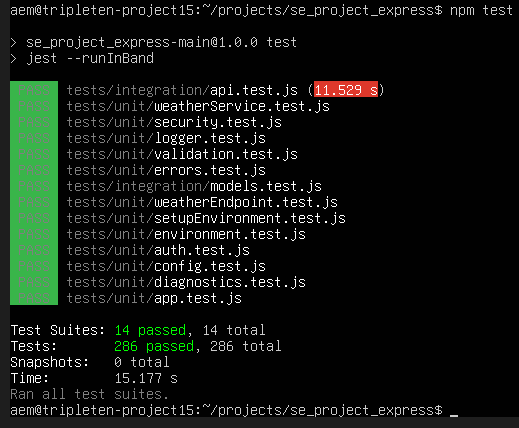

# Sprint 15 — Ubuntu Server Installation, SSH, Firewall and Express Validation

> **Period covered:** October 24–30, 2026 · **Written:** October 31, 2026  
> **Evidence basis:** Recorded terminal output, configuration screenshots, and observed results from the Sprint 15 walkthrough. This is a reconstruction of verified work, **not** a fresh audit of the powered-off VM.  
> **Related:** [01 — Historical VirtualBox setup](01-virtual-machine.md) · [03 — Cloud deployment](../render/03-cloud-deployment.md) · [04 — Verification/runbook](../04-verification-and-runbook.md)

## 1. Scope and architectural decision

The local VM `TripleTen-Project15` is a **private infrastructure lab**, not a public server. The independently hosted application uses **GitHub Pages (React)**, **Render (Express)**, and **MongoDB Atlas (persistent cloud data)**. The VM was used for learning and verifying server administration, SSH, networking, dependency installation and Linux tests. Running the backend under PM2/Nginx in the VM is **not completed**.

Keep local and cloud secrets and databases distinct. The host's Windows MongoDB server and the Atlas database are separate; no replication between them was configured. The 286 Jest tests use disposable `mongodb-memory-server` databases, not these persistent databases.

## 2. Guest OS and virtual hardware

| Property | Verified or configured value |
|---|---|
| Host | Windows 11 Home, Ryzen 9 9900X, VirtualBox 7.2.22 |
| Guest | Ubuntu Server 24.04.5 LTS (codename `noble`) |
| VM name / hostname | `TripleTen-Project15` / `tripleten-project15` |
| Guest account | `aem` (normal user, with sudo) |
| Guest architecture | `amd64` |
| CPU / memory | **1 vCPU** after troubleshooting; 4069 MB configured, ~3.8 GiB available to Linux |
| Disk | Approx. 50 GB virtual disk; Ubuntu installed on encrypted LUKS/LVM storage |
| Firmware | EFI; VirtualBox's saved `SecureBoot="on"` observed |
| Guest running kernel after upgrades | `6.8.0-147-generic` |
| Interfaces | Adapter 1 NAT on `enp0s3`; other adapters disabled |
| Nonessential guest hardware | USB, audio, clipboard, drag/drop and shared folders disabled |

### Virtualization / boot troubleshooting

Two vCPUs produced guest kernel RCU stalls / unresponsive boot behavior while VirtualBox was operating with Windows VBS and the Windows hypervisor. Reducing the VM to **one vCPU** allowed Ubuntu to boot consistently without disabling the host's security protections. This is an *observed workaround*, not proof that all VirtualBox/VBS combinations require one vCPU.

Secure Boot checkbox persistence was checked via `VBoxManage` (`SecureBoot="on"`). The complete guest-side enforcement and key-enrollment evidence was not captured in the documentation; do **not** claim measured enforcement. The server uses LUKS encryption and requires its unlock passphrase when rebooted.

### Operating system verification commands

```bash
cat /etc/os-release
uname -r
hostname
lsb_release -cs
dpkg --print-architecture
free -h
```

Evidence observed included `noble`, `amd64`, `tripleten-project15`, and kernel `6.8.0-147-generic`. The output `No LSB modules are available` from `lsb_release` was harmless.

## 3. Windows-local SSH access

The VM uses NAT and has **one intentionally configured inbound NAT forwarding rule**, created after the original pre-boot snapshot:

```text
VirtualBox rule name: ssh-local
Host interface/address: 127.0.0.1
Host TCP port: 2222
Guest TCP port: 22
```

This permits SSH from Windows through its **own localhost**, without opening port 22 to the LAN or forwarding router ports. A guest-local SSH service was started and the Windows host verified key-based login. The guest's ED25519 public key was added to `~/.ssh/authorized_keys`, with private key stored on Windows, protected by a passphrase.

**Verified Windows PowerShell SSH pattern (no private key value is shown):**

```powershell
ssh -i "$HOME\.ssh\tripleten-project15_ed25519" -p 2222 `
  -o IdentitiesOnly=yes `
  -o PreferredAuthentications=publickey `
  -o PasswordAuthentication=no `
  -o KbdInteractiveAuthentication=no `
  aem@127.0.0.1 "whoami; hostname; uname -r"
```

Observed response: `aem`, `tripleten-project15`, `6.8.0-147-generic`.

**SSHD hardening** was saved in `/etc/ssh/sshd_config.d/00-local-hardening.conf` with restrictive file permissions:

```text
PermitRootLogin no
PasswordAuthentication no
KbdInteractiveAuthentication no
PubkeyAuthentication yes
UsePAM yes
```

Guest account's `~/.ssh` permissions were set to `700`, and `authorized_keys` to `600`. SSH was tested after upgrade/reboot.

**Security caveat:** An allowlist or loopback-only NAT forwarding is not proof that a compromised guest can never access the host. VirtualBox NAT, host firewall enforcement and guest UFW are different control layers. Host-enforced isolation and adversarial tests remain unverified.

## 4. Network, DNS and firewall

### Addressing and isolation choices

The guest's NAT interface `enp0s3` obtained private IPv4 `10.0.2.15/24`, gateway `10.0.2.2`. The VirtualBox DNS proxy was used at `10.0.2.3`. The Windows host's local LAN used the `10.0.0.0/24` address family. The NAT host-loopback helper was disabled (`localhostReachable="0"`).

Network configuration was saved in `/etc/netplan/01-virtualbox-nat.yaml` (permissions `600`):

```yaml
network:
  version: 2
  renderer: networkd
  ethernets:
    enp0s3:
      dhcp4: true
      dhcp6: false
      accept-ra: false
      optional: true
      dhcp4-overrides:
        use-dns: false
        use-domains: false
      nameservers:
        addresses:
          - 10.0.2.3
```

The VirtualBox host resolver option was enabled for NAT adapter 1. DNS resolved official Ubuntu package hosts, and outbound HTTP/HTTPS tests were successful after configuration. No broad IPv6 HTTP/HTTPS allow rules were added; IPv6 firewall policy was retained.

### Guest UFW rules (observed numbered order)

UFW was enabled with default policies **deny incoming, deny outgoing**, and routed traffic denied. The following IPv4 rules were verified; order matters:

| Rule | Type | Purpose |
|---|---|---|
| 1 | Deny outbound `10.0.0.0/24` | Explicitly restrict home LAN segment (subsumed by /8 below) |
| 2 | Deny outbound `172.16.0.0/12` | Private IPv4 range |
| 3 | Deny outbound `192.168.0.0/16` | Private IPv4 range |
| 4 | Allow inbound SSH `22/tcp` from `10.0.2.2` on `enp0s3` | Windows-host NAT SSH path |
| 5 | Allow outbound `67/udp` on `enp0s3` | DHCP |
| 6–7 | Allow outbound DNS `10.0.2.3:53/udp` and `:53/tcp` | DNS via VirtualBox |
| 8 | Deny outbound `10.0.0.0/8` | Other private IPv4 within that block |
| 9–10 | Allow outbound `80/tcp` and `443/tcp` (IPv4) | Package downloads and HTTPS |

**Verify rather than reapply blindly:**

```bash
sudo ufw status verbose
sudo ufw status numbered
resolvectl status enp0s3
ip -4 address show enp0s3
```

This is intentionally restrictive for the lab. A future Atlas connection from Ubuntu may require a deliberate outbound rule for database traffic (often port 27017) and careful destination scoping. Do not open blanket ports or change rules before deciding the VM's final data architecture.

**Important limits:** Guest UFW is **not** host-enforced segmentation and can be altered by a process with sufficient guest privileges; allow rules on 80/443 are not domain-specific; other guest-to-host pathways and IPv6 behavior have not been established by a penetration test. The VM is not publicly exposed.

## 5. Guest patching and recovery snapshot

A VirtualBox snapshot was created before a substantial Ubuntu package upgrade:

```text
Snapshot: pre-apt-upgrade-2026-10-28
Snapshot UUID: 4d7b5b7f-d4d2-4290-adda-afabfe28a231
```

APT simulation and upgrades were examined before execution. The guest was rebooted successfully after updates; the kernel changed from the earlier 6.8.0-139 family to **6.8.0-147-generic**. APT then reported no available upgrades, and `dpkg --audit` reported no package-accounting problems at the time checked.

The preferred IPv4-only APT update invocation was:

```bash
sudo apt-get -o Acquire::ForceIPv4=true update
```

**Caution:** A VirtualBox snapshot is a convenient rollback checkpoint, **not** an independent, off-machine backup. A snapshot restore exercise was not documented; recovery testing remains open.

## 6. Runtime and source setup

| Tool | Verified Ubuntu value |
|---|---|
| Node.js | `v24.22.2` |
| npm | `11.19.1` |
| Git | `2.43.0` |
| Express clone | `~/projects/se_project_express` |
| Backend Git commit | `7e4278c` (`fix: update body-parser to patched 2.4.0`) |

The committed repository was cloned from `https://github.com/AEMxr/se_project_express.git`, then advanced using `git pull --ff-only origin main`. Local Windows documentation edits had been pushed before the original clone. Dependency installation used `npm ci`, respecting the committed lockfile.

```bash
cd ~/projects/se_project_express
git status --short --branch
git log -1 --oneline
node --version
npm --version
npm ls body-parser
npm audit --omit=dev
```

Results: `body-parser@2.4.0` under Express 5.1.0, and **0 reported production npm audit vulnerabilities** at that point. The full install still reported **six development-tree findings** (five low, one high). Deprecation notices and unapproved npm install scripts for `@parcel/watcher` and `unrs-resolver` were observed; no blind approval or forced audit fix was performed.

### Backend tests — real results

| Test location | Result |
|---|---|
| Windows after lockfile patch | **14/14 suites, 286/286 tests** passed |
| Ubuntu from patched Git revision | **14/14 suites, 286/286 tests** passed in 15.177 s |
| Windows lint | Passed |
| Windows Prettier check | Passed |

Screenshot from the actual Ubuntu run:



The integration tests started **temporary** MongoDB databases under `mongodb-memory-server`. Their success did not establish an installed permanent MongoDB daemon.

### Private runtime configuration

The backend's built-in `npm run setup:env` generated `.env.local` on Ubuntu; owner `aem`, permissions `600`, and `git status` remained clean because the file is ignored. The secret passed a **non-disclosing** check for a 64-hex-character JWT signing value:

```bash
grep -Eq '^JWT_SECRET=[0-9a-f]{64}$' .env.local && echo 'JWT signing secret verified'
stat -c '%a %U:%G %n' .env.local
```

Local development, the VM and Render appropriately have **different JWT signing secrets**. A JWT signing secret is an Express authentication secret; it is not a MongoDB database password. Do not copy secrets into documentation.

## 7. MongoDB architecture discovery

Before installing `mongod` on the VM, existing data sources were identified:

| Location | Database | Evidence |
|---|---|---|
| Windows host | `wtwr_db` | Successful local Mongoose connection to `127.0.0.1:27017`; 3 user records, 2 clothing items, GridFS `garmentPhotos.files` and `.chunks` |
| Atlas cluster `tripleten` | `wtwr_db` | Data Explorer reported 5 users and 12 clothing items; also `sample_mflix` dataset |
| Render/Atlas | `wtwr_render` | Separate database, created for hosted WTWR; later verified account and clothing persistence |

These databases are **not known to replicate or sync**. Counts alone do not establish which data is newer or whether records overlap. The project chose to leave all existing data intact and to use a dedicated Atlas database for Render.

**No persistent MongoDB server was installed inside Ubuntu.** A mistaken `apt-get install ca-certifications` command failed with “Unable to locate package,” before changing MongoDB; the correct Ubuntu package name is `ca-certificates`. No MongoDB package repository was added as part of that failed step.

### Redundancy plan (design, not implementation)

- Atlas: application data and cloud availability mechanisms.
- Independently protected cloud backups: data recovery (pending).
- Local/VM restore: test `mongodump`/`mongorestore` with isolated disposable data; **not** an active replica (pending).
- Optional per-device cache in a future app: offline access, with deliberate conflict handling (not part of Sprint 15's implemented backend).

## 8. Restart and operational instructions

To shut down safely while logged into Ubuntu:

```bash
sudo shutdown -h now
```

Then confirm VirtualBox Manager shows **Powered Off**. Avoid forcibly powering off a running guest. Upon boot, the encrypted system requires its LUKS unlock passphrase. SSH port forwarding is localhost-only as noted above.

The VM was shut down safely while cloud configuration continued. The installed source and settings persist across a normal shutdown. PM2/Nginx/serving the real application on the VM remain tasks for the next lab phase.

## 9. Remaining Ubuntu milestones

1. Decide whether the VM backend should use a **new isolated cloud lab database** or a dedicated local database. Keep `wtwr_render` production/course-demo data separate.
2. Configure and test PM2 or the course-required process manager, including restart/reboot behavior.
3. Configure Nginx proxy and serve a built React frontend on the VM without broadening external exposure.
4. Add reproducible smoke tests and server/network evidence. Test rate limiting behind reverse proxy and explicit error/recovery cases.
5. Verify Secure Boot enforcement and review host-side isolation; capture read-only evidence.
6. Verify an actual backup/restore path, not merely a VM snapshot.

Use [04 — Verification and runbook](../04-verification-and-runbook.md) and [05 — Private VM application deployment log](05-vm-application-deployment.md) for the next checkpoints and evidence.
