# Sprint 15 — Private Ubuntu Application Deployment: Checkpoint Log

> **Started:** October 31, 2026  
> **Historical baseline (Oct. 31):** MongoDB 8.0.34 successfully started on Ubuntu; `systemctl is-active mongod` returned `active`, `ss` showed `127.0.0.1:27017`, and `mongosh` ping returned `1` (checkpoint 15AS.3). The VM `.env.local` is Git-ignored and now explicitly targets the local `wtwr_vm_lab` database (15AS.5). File mode `600` and a clean Git branch were confirmed. Application-level Mongoose connectivity to `wtwr_vm_lab` is verified (15AS.6). **PM2 7.1.1 now supervises Express as `aem`** and its logs confirm MongoDB connected and port 3001 listening (15AT.2). Guest-local HTTP responses, listening-interface assessment, service boot persistence, Nginx, and recovery testing remain pending.  
> **Latest (Nov. 12 Pacific):** Recovered after network relocation/reboot: `mongod` manually restored and verified `active`/`enabled`, PM2 `wtwr-vm-api` manually restored `online`, fresh MongoDB/port 3001 log messages; HTTP smoke check and actual boot persistence still **pending**. See 15AT.3–15AT.8 below.  
> **Evidence policy:** Each checkpoint is **pending** until its actual terminal output or observed behavior is recorded. Do not confuse planned steps below with commands already performed.  
> **Related:** [Ubuntu baseline](02-ubuntu-operations.md) · [Cloud deployment](../render/03-cloud-deployment.md) · [Verification / recovery](../04-verification-and-runbook.md)

## A. Scope and separation

The functional public application remains independent of the private lab:

- **Public UI:** GitHub Pages, `https://aemxr.github.io/se_project_react/`.
- **Public API:** Render, `https://wtwr-express-api.onrender.com/`.
- **Public application database:** Atlas `wtwr_render`; **never** use its live credentials or records for destructive VM experiments.
- **Private lab:** VirtualBox VM `TripleTen-Project15` on Windows 11. Lab is for SSH, Linux, process supervision, Nginx, private frontend serving, application reliability, and recovery exercises.

The Ubuntu VM has the cloned backend and **286 passing Jest tests**. **MongoDB Community Server 8.0.34 has been installed**, with installed packages and configured loopback-only binding verified; its service is now **running** with a verified `127.0.0.1:27017` socket and successful local database ping (15AS.3); PM2 is running Express on port 3001 (15AT.2), but no verified Nginx deployment exists. Its existing `.env.local` contains a separate JWT signing secret and now a guest-local MongoDB URI, not Atlas credentials. The Windows local `wtwr_db` and Atlas `wtwr_db` are also distinct; neither is a failover or backup service for `wtwr_render`.

**Security boundary:** The lab must not become a public server. Do not open router ports, add bridged adapters, forward public host ports, or expose the host's MongoDB to the VM. Guest UFW alone is not host-enforced network isolation. Existing localhost-only SSH forwarding is the one recorded exception.

## B. Documentation method — apply after every verified checkpoint

1. Run the next small command or action; retain the **exact** console result or a redacted screenshot.
2. Record: **date**, **goal**, **command**, **observed output**, **conclusion**, and **rollback/next step**. Never substitute an expected result for an observed one.
3. Keep secrets, JWT values, database URIs, cloud credentials, private keys and passwords out of Markdown, screenshots and Git history.
4. Update this log and the status tables in `../04-verification-and-runbook.md` as applicable. Rebuild the ZIP from the package root; keep relative `images/` links intact.
5. Review changes before merging into `se_project_express/docs/deployment/` and committing.

## C. Checkpoint 15AK — Resume and inspect the existing VM (RESOLVED: POST-BOOT CONFIGURATION VERIFIED)

**Inspection date:** October 31, 2026  
**Host/terminal:** Windows PowerShell 7  
**Goal:** Check the current VirtualBox state and compare it to the prior security baseline. This was a **read-only** host-side query; no setting was changed.

**Command actually run:**

```powershell
& "$env:ProgramFiles\Oracle\VirtualBox\VBoxManage.exe" showvminfo "TripleTen-Project15" --machinereadable |
  Select-String -Pattern 'VMState|cpus=|memory=|SecureBoot|nic[1-8]=|localhostReachable|Forwarding|natpf|cableconnected1'
```

**Observed output (verbatim relevant lines):**

```text
memory=4069
cpus=1
SecureBoot="on"
VMState="running"
VMStateChangeTime="2026-10-31T17:01:17.941000000"
cableconnected1="on"
nic1="nat"
localhostReachable="1"
Forwarding(0)="ssh-local,tcp,127.0.0.1,2222,,22"
nic2="none"
nic3="none"
nic4="none"
nic5="none"
nic6="none"
nic7="none"
nic8="none"
```

**Assessment:** **PARTIAL PASS, CONFIGURATION DRIFT FOUND**. The guest was already running, with one vCPU, 4069 MB of RAM, saved Secure Boot enabled, a connected NAT adapter, no secondary NICs, and the expected SSH inbound mapping restricted to the Windows host's loopback interface (`127.0.0.1:2222 → guest:22`). However, `localhostReachable="1"` indicates the *guest-to-host localhost NAT access feature is enabled*, differing from our previously recorded `localhostReachable="0"`. **These two features are separate:** the host-loopback-only SSH rule controls inbound access from Windows to the guest, whereas `localhostReachable` affects guest attempts to reach Windows-host loopback services. Do not claim that NAT localhost reachability is currently disabled. The reason the setting changed is **unknown**.

**Other limitations:** The configured Secure Boot value does not by itself verify enrolled keys or in-guest enforcement. This query did not test guest SSH access, DNS, UFW, host-side isolation, or the application's live status. The absence of additional forwarding lines means none were shown in the output, not a network penetration test.

**Corrective procedure requested on October 31 (NOW PERFORMED AND VERIFIED BELOW):** Gracefully shut down Ubuntu using `sudo shutdown -h now` from the guest terminal; confirm `VMState="poweroff"` in Windows PowerShell. With the VM fully powered off, reapply the previously established configuration:

```powershell
& "$env:ProgramFiles\Oracle\VirtualBox\VBoxManage.exe" modifyvm "TripleTen-Project15" --nat-localhostreachable1 off
```

Then re-read the saved configuration to verify `localhostReachable="0"`, restart the VM through VirtualBox, unlock LUKS, and confirm SSH and DNS functionality. **The result of the correction is recorded below.** Guest UFW rules also remain separate from host-enforced isolation.

| Field | Verified result / pending status |
|---|---|
| PowerShell inspection date | **2026-10-31** |
| Saved VM state | **Running** at first inspection; later **powered off** for correction |
| SSH forwarding | **Present**, bound to Windows 127.0.0.1:2222 → guest:22 |
| NAT localhost reachability | **1 during initial inspection**; subsequently **0 in saved powered-off configuration** (see correction below) |
| Boot after correction | **Verified running** October 31; LUKS interaction was not separately captured |
| SSH reconnect / kernel version after correction | **PASS:** `aem`, `tripleten-project15`, `6.8.0-147-generic` |
| NAT correction persists while running | **PASS:** `localhostReachable="0"` and SSH mapping retained |
| Firewall and DNS post-correction | **PASS 15AL**: UFW active, expected ten rules, SSH active, DNS 10.0.2.3; backend Git checkout clean |

### 15AK.1 — Restore NAT localhost restriction (VERIFIED)

**Date:** October 31, 2026  
**Host/terminal:** Windows PowerShell 7 (after user-initiated graceful guest shutdown)  
**Goal:** Return NAT host-loopback reachability to the documented disabled baseline while retaining localhost-only SSH forwarding.

**Commands executed, in order:**

```powershell
& "$env:ProgramFiles\Oracle\VirtualBox\VBoxManage.exe" showvminfo "TripleTen-Project15" --machinereadable |
  Select-String '^VMState='

& "$env:ProgramFiles\Oracle\VirtualBox\VBoxManage.exe" modifyvm "TripleTen-Project15" --nat-localhostreachable1 off

& "$env:ProgramFiles\Oracle\VirtualBox\VBoxManage.exe" showvminfo "TripleTen-Project15" --machinereadable |
  Select-String 'VMState|localhostReachable|Forwarding'
```

**User-supplied observed output (relevant lines, verbatim):**

```text
VMState="poweroff"

VMState="poweroff"
VMStateChangeTime="2026-10-31T23:31:50.067000000"
localhostReachable="0"
Forwarding(0)="ssh-local,tcp,127.0.0.1,2222,,22"
```

**Assessment: PASS for saved, powered-off VirtualBox configuration.** The VM was powered off before `modifyvm`; the command completed without a reported error; saved NAT localhost reachability now reports **disabled** while the localhost-only inbound SSH forwarding rule remains. This also establishes that the relevant shutdown occurred before the command; the exact shutdown console output was not supplied. The timestamp is from VirtualBox and includes a UTC `Z` marker.

**Remaining limitation at the end of 15AK.1:** This was initially a saved-configuration check. Subsequent post-boot SSH and VirtualBox state were **verified** in 15AK.2 below. Neither check tests guest-to-host reachability or independently enforces host/LAN isolation. The reason for the earlier drift remains unknown.

### 15AK.2 — Guest restart, SSH validation and NAT setting persistence (VERIFIED)

**Date:** October 31, 2026  
**Host/terminal:** Windows PowerShell 7, after the user booted the VM  
**Goal:** Verify private-key SSH access and confirm that NAT localhost restrictions persist in the running VM.

**User-executed commands:**

```powershell
ssh -i "$HOME\.ssh\tripleten-project15_ed25519" -p 2222 `
  -o IdentitiesOnly=yes `
  -o PreferredAuthentications=publickey `
  -o PasswordAuthentication=no `
  -o KbdInteractiveAuthentication=no `
  aem@127.0.0.1 "whoami; hostname; uname -r"

& "$env:ProgramFiles\Oracle\VirtualBox\VBoxManage.exe" showvminfo "TripleTen-Project15" --machinereadable |
  Select-String 'VMState|localhostReachable|Forwarding'
```

**Observed output (verbatim; private SSH key passphrase omitted):**

```text
aem
tripleten-project15
6.8.0-147-generic

VMState="running"
VMStateChangeTime="2026-10-31T23:34:06.027000000"
localhostReachable="0"
Forwarding(0)="ssh-local,tcp,127.0.0.1,2222,,22"
```

**Assessment: PASS.** The guest is running, the Windows host successfully authenticated over SSH using the password-protected Ed25519 private key, the expected Ubuntu kernel is running, and VirtualBox reports NAT localhost reachability disabled **while the VM is running**. The localhost-only SSH host forward is still present. The earlier configuration drift is now corrected and verified after reboot.

**Evidence limitation:** SSH connectivity does not independently prove strict host/LAN isolation; no negative guest-to-host or private-network connectivity test was performed. Secure Boot remains confirmed as a saved VirtualBox setting, not independently verified for in-guest enforcement in this checkpoint. Post-boot UFW, DNS and listening sockets remain to be inspected. The VM booted, but no separate LUKS-unlock console evidence was supplied.

### 15AL — Ubuntu firewall, DNS and app checkout inspection (VERIFIED)

**Date:** October 31, 2026  
**Guest/terminal:** Ubuntu Bash (`aem@tripleten-project15`)  
**Goal:** Verify guest firewall rules, running SSH daemon, DNS resolver, and local backend repository state after VM network configuration repair. No guest configuration changes.

**Commands performed:**

```bash
sudo ufw status numbered
systemctl is-active ssh
resolvectl dns enp0s3
git -C ~/projects/se_project_express status --short --branch
```

**User-supplied observed results, reformatted from screenshot (rule numbers/comments preserved; password prompt omitted):**

```text
Status: active

[ 1] DENY OUT 10.0.0.0/24 on enp0s3          # Block home LAN
[ 2] DENY OUT 172.16.0.0/12 on enp0s3        # Block private LAN 172
[ 3] DENY OUT 192.168.0.0/16 on enp0s3      # Block private LAN 192
[ 4] ALLOW IN  22/tcp on enp0s3 from 10.0.2.2 # VirtualBox NAT SSH
[ 5] ALLOW OUT 67/udp on enp0s3              # VirtualBox DHCP
[ 6] ALLOW OUT 10.0.2.3 53/udp on enp0s3     # VirtualBox DNS UDP
[ 7] ALLOW OUT 10.0.2.3 53/tcp on enp0s3     # VirtualBox DNS TCP
[ 8] DENY OUT 10.0.0.0/8 on enp0s3          # Block private range 10
[ 9] ALLOW OUT 80/tcp on enp0s3             # HTTP package repositories
[10] ALLOW OUT 443/tcp on enp0s3            # HTTPS outbound IPv4

systemctl is-active ssh:
active

resolvectl dns enp0s3:
Link 2 (enp0s3): 10.0.2.3

git -C ~/projects/se_project_express status --short --branch:
## main...origin/main
```

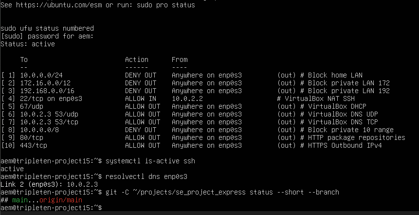

**Assessment: PASS for this read-only checkpoint.** The guest UFW firewall is active and reports the ten rules we configured earlier. SSH is active. DNS remains pointed at VirtualBox's NAT resolver `10.0.2.3`. Backend checkout is on `main`, tracking `origin/main`, with no shown working-tree modifications. Combined with 15AK.2, these results establish the intended VM settings persisted after a restart.

**Important limitations:** `ufw status numbered` does not display UFW's default incoming/outgoing/routed policies; check those explicitly with `sudo ufw status verbose`. These entries describe configured guest policy, not a proven host-enforced security boundary. No negative connectivity test to the Windows host/LAN, DNS query timing check, service-port enumeration, or in-guest Secure Boot enforcement check was performed in this checkpoint. The document list does not imply the guest has MongoDB, PM2 or Nginx installed. The comment text on UFW rules is administrator annotation, not independent proof that all traffic to those targets is blocked.

**Next planned checkpoint 15AM:** Read-only readiness check before deciding on an **isolated guest-local MongoDB** for the PM2/Nginx learning lab. Do not connect to or modify Atlas `wtwr_render`, and do not create new host-facing port forwarding.

```bash
sudo ufw status verbose
df -h /
free -h
command -v mongod || echo "MongoDB server is not installed on this VM"
```

Record output before installing software. `df` and `free` verify space and memory; `command -v mongod` only checks executable availability, not service state or the full package inventory.

### 15AM — Database readiness: firewall defaults, resources and installed server (VERIFIED; DB install NOT STARTED)

**Date:** October 31, 2026  
**Guest/terminal:** Ubuntu Bash (`aem@tripleten-project15`)  
**Goal:** Confirm guest firewall default policy, available space/memory, and whether MongoDB server is present, without changing VM configuration.

**Commands actually run:**

```bash
sudo ufw status verbose
df -h /
free -h
command -v mongod || echo "MongoDB server is not installed on this VM"
```

**Observed results** (transcribed from the user-provided terminal screenshot; fields preserved):

```text
Status: active
Logging: on (low)
Default: deny (incoming), deny (outgoing), disabled (routed)
New profiles: skip

To                           Action      From
22/tcp on enp0s3             ALLOW IN    10.0.2.2     # VirtualBox NAT SSH
10.0.0.0/24                  DENY OUT    Anywhere on enp0s3
172.16.0.0/12                DENY OUT    Anywhere on enp0s3
192.168.0.0/16               DENY OUT    Anywhere on enp0s3
67/udp                       ALLOW OUT   Anywhere on enp0s3
10.0.2.3 53/udp              ALLOW OUT   Anywhere on enp0s3
10.0.2.3 53/tcp              ALLOW OUT   Anywhere on enp0s3
10.0.0.0/8                   DENY OUT    Anywhere on enp0s3
80/tcp                       ALLOW OUT   Anywhere on enp0s3
443/tcp                      ALLOW OUT   Anywhere on enp0s3

Filesystem                      Size Used Avail Use% Mounted on
/dev/mapper/ubuntu--vg-ubuntu--lv 40G 7.6G 30G 21% /

               total   used    free   shared  buff/cache  available
Mem:           3.8Gi   408Mi  3.3Gi  1.0Mi   278Mi       3.4Gi
Swap:          3.8Gi   0B     3.8Gi

MongoDB server is not installed on this VM
```

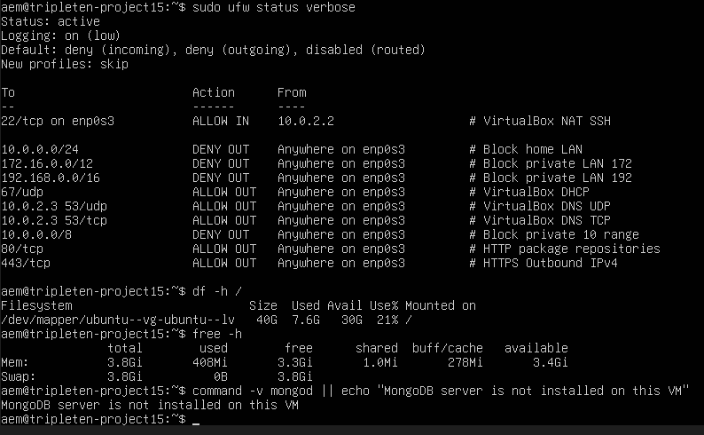

**Assessment: PASS (read-only preflight only).** UFW reports `deny` for incoming and outgoing traffic and `disabled` for routed traffic. The VM has approximately **30 GiB free** on the root filesystem and **3.4 GiB available RAM**, with swap unused. `mongod` was **not found on `PATH`**; this is evidence that the server executable is not installed in the usual environment, not exhaustive evidence of package absence. **No MongoDB installation, database connection, PM2 setup, or Nginx setup occurred during this checkpoint.**

**Security and resource considerations:** The firewall currently allows only designated outbound destinations/ports; local MongoDB on guest loopback would not need an inbound firewall exception. UFW policy alone is not host-side network isolation. With one virtual CPU and roughly 4 GiB RAM, monitor actual memory and CPU load when multiple services run. The public Atlas `wtwr_render` service remains separate and unchanged.

**Checkpoint 15AM.1 — Guest CPU flags and installation prerequisites (VERIFIED; initial typo corrected):** MongoDB's supported Ubuntu 24.04 Community Edition install method uses its signed APT repository. MongoDB 5.0+ requires AVX on x86_64; verify what VirtualBox exposes *inside the guest* before installing anything. Check tools and OS architecture read-only:

```bash
if grep -qm1 -w avx /proc/cpuinfo; then echo 'AVX: available in guest'; else echo 'AVX: NOT reported in guest'; fi
lsb_release -cs
dpkg --print-architecture
for tool in curl gpg; do command -v "$tool" || echo "$tool: missing"; done
```

If AVX is missing, **stop**: do not install MongoDB 8.0 or change Windows host security settings simply to enable it. Evaluate an alternative isolated lab database strategy. Otherwise continue with explicit package trust and APT steps, each verified separately. No application ports are to be published to the host/LAN.

**Primary references:**
- [MongoDB 8.0 Community Edition: Ubuntu APT installation and supported Noble architecture](https://www.mongodb.com/docs/v8.0/tutorial/install-mongodb-on-ubuntu/)
- [MongoDB production notes: x86_64 AVX requirement](https://www.mongodb.com/docs/manual/administration/production-notes/)

### 15AM.1 — Guest CPU feature and MongoDB install-tool check (VERIFIED after follow-up)

**Date:** October 31, 2026  
**Guest/terminal:** Ubuntu Bash (`aem@tripleten-project15`)  
**Goal:** Verify the guest exposes AVX and Ubuntu 24.04 `noble`, confirm `curl` and `gpg`, and check APT package architecture before any MongoDB installation. No changes were made to the server.

**Commands attempted and observed output** (user-supplied screenshot; extraneous prompt lines omitted):

```bash
command -v mongod || echo "MongoDB server is not installed on this VM"
# MongoDB server is not installed on this VM

if grep -qm1 -w avx /proc/cpuinfo; then
  echo "AVX: available in guest"
else
  echo "AVX: NOT reported in guest"
fi
# AVX: available in guest

lsb_release -cs
# No LSB modules are available.
# noble

dpgk --print-architecture  # typo; intended dpkg
# Command 'dpgk' not found, did you mean: Command 'dpkg' from deb dpkg ...

for tool in curl gpg; do
  command -v "$tool" || echo "$tool: missing"
done
# /usr/bin/curl
# /usr/bin/gpg
```

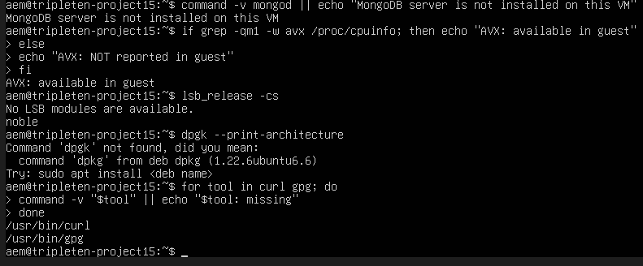

**Assessment: PARTIAL PASS on the initial screenshot; follow-up architecture check passed.** AVX is exposed inside VirtualBox; Ubuntu reports codename `noble`; and both `curl` and `gpg` executables are present. The warning `No LSB modules are available` did not prevent the codename lookup. The package architecture **was not checked by this command**, because the user typed `dpgk` instead of `dpkg`. This typo did not modify packages, networking, or database content. The architecture was shown as `amd64` in an earlier guest session; a fresh corrected command has now confirmed it again (15AN below).

**Next step:** inspect MongoDB's official 8.0 public signing key locally before making any APT repository or package changes. Guest/host isolation and MongoDB package signature verification remain independent outstanding work.


### 15AN — Confirm package architecture (VERIFIED)

**Date:** October 31, 2026  
**Guest/terminal:** Ubuntu Bash  
**Goal:** Confirm the package architecture after the `dpgk` typo in the preceding checkpoint. Read-only; no installation performed.

**User-reported command and result:**

```bash
dpkg --print-architecture
# amd64
```

**Assessment: PASS.** This confirms the guest's Debian package architecture is `amd64`; earlier results also verified `noble`, AVX, `curl`, and `gpg`. The guest therefore meets the basic platform prerequisites for MongoDB Community 8.0 on Ubuntu 24.04. This does **not** establish that the MongoDB signing key, package source, or installed service have been verified; MongoDB has not been installed.

**Next checkpoint requested at that point, now performed and verified:** Download the MongoDB 8.0 public key and inspect its identity and fingerprint. The actual result appears in checkpoint 15AO below. The original suggested commands were:

```bash
curl -fsSLo /tmp/mongodb-server-8.0.asc https://pgp.mongodb.com/server-8.0.asc
gpg --show-keys --fingerprint /tmp/mongodb-server-8.0.asc
```

This downloads a **public signing key** into `/tmp` and prints its metadata. No `mongodb-org` installation, repository trust change, firewall alteration, or database access is performed. Stop and investigate if the download fails or the key identity is unexpected. Official reference: https://www.mongodb.com/docs/v8.0/tutorial/install-mongodb-on-ubuntu/

### 15AO — Inspect MongoDB 8.0 public signing key (VERIFIED)

**Date:** October 31, 2026  
**Guest/terminal:** Ubuntu Bash (`aem@tripleten-project15`)  
**Goal:** Retrieve and examine MongoDB's official 8.0 public signing key without installing software or modifying APT trust.  
**Method:** HTTPS download from the URL specified in MongoDB's Ubuntu 8.0 documentation, followed by read-only GPG key display.  

**Commands actually run:**

```bash
curl -fsSLo /tmp/mongodb-server-8.0.asc https://pgp.mongodb.com/server-8.0.asc
gpg --show-keys --fingerprint /tmp/mongodb-server-8.0.asc
```

**Observed output (relevant lines):**

```text
gpg: directory '/home/aem/.gnupg' created
gpg: keybox '/home/aem/.gnupg/pubring.kbx' created
pub   rsa4096 2024-01-11 [SC]
      4B07 52C1 BCA2 38C0 B4EE  14DC 41DE 058A 4E7D CA05
uid           MongoDB 8.0 Release Signing Key <packaging@mongodb.com>
```

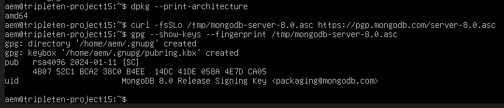

**Assessment: PASS for key download and inspection.** The fingerprint shown in the guest matches an example posted on MongoDB's own community forum, and MongoDB's official installation guide refers to the `server-8.0.asc` key URL. This establishes the observed key identity and provides corroboration, but the UID string alone is not a cryptographic trust proof. APT must still validate signed repository metadata using a narrowly scoped `signed-by` keyring before trusting packages. The new local `.gnupg` directory/keybox is ordinary GPG user state. No packages were installed and no service or firewall configuration was altered.

**Checkpoint 15AP was subsequently completed and verified; actual evidence is recorded below.** The following commands had been proposed as the checkpoint instructions:

```bash
gpg --batch --dearmor --output /tmp/mongodb-server-8.0.gpg /tmp/mongodb-server-8.0.asc
sudo install -o root -g root -m 0644 /tmp/mongodb-server-8.0.gpg /usr/share/keyrings/mongodb-server-8.0.gpg
gpg --show-keys --fingerprint /usr/share/keyrings/mongodb-server-8.0.gpg
```

**References:**
- Official installation instructions: https://www.mongodb.com/docs/v8.0/tutorial/install-mongodb-on-ubuntu/
- MongoDB-hosted community example that displays the same fingerprint: https://www.mongodb.com/community/forums/t/unable-to-install-mongodb-due-to-gpg-key-errors/302069


### 15AP — Install the MongoDB 8.0 scoped APT signing keyring (VERIFIED)

**Date:** October 31, 2026  
**Guest/terminal:** Ubuntu Bash (`aem@tripleten-project15`)  
**Goal:** Convert the previously inspected MongoDB 8.0 ASCII signing key into a binary keyring and install it in the conventional APT keyring directory. Confirm it contains the same public key; **do not** yet configure any APT source or install MongoDB.

**Commands executed (from supplied terminal screenshot):**

```bash
gpg --batch --dearmor --output /tmp/mongodb-server-8.0.gpg /tmp/mongodb-server-8.0.asc
sudo install -o root -g root -m 0644 /tmp/mongodb-server-8.0.gpg /usr/share/keyrings/mongodb-server-8.0.gpg
gpg --show-keys --fingerprint /usr/share/keyrings/mongodb-server-8.0.gpg
```

**Observed output (final command):**

```text
pub   rsa4096 2024-01-11 [SC]
      4B07 52C1 BCA2 38C0 B4EE  14DC 41DE 058A 4E7D CA05
uid           MongoDB 8.0 Release Signing Key <packaging@mongodb.com>
```

The `gpg --dearmor` and `sudo install` commands returned to the shell with no visible error; the subsequent verification read the public key from the newly installed `/usr/share/keyrings/mongodb-server-8.0.gpg`. The `install` command requested root ownership and file mode `0644`; an independent `stat` ownership/permission check has not yet been captured.

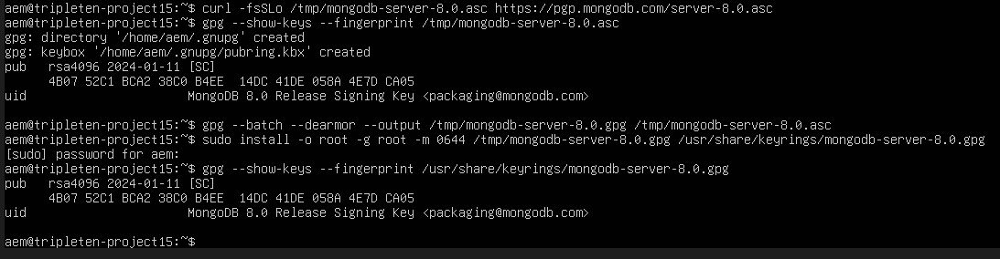

**Assessment: PASS.** The installed keyring contains the same MongoDB 8.0 public key as the inspected download. The keyring alone does **not** authorize MongoDB repositories: the `signed-by=` reference in a source file is still required. APT has **not yet fetched or cryptographically validated** the repository metadata, and `mongod` remains uninstalled. No firewall rule, production Atlas credential or database content was changed.

**Next checkpoint — 15AQ (subsequently VERIFIED; see the result below):** Add the MongoDB 8.0 Ubuntu `noble` repository using this exact `signed-by` keyring, **then inspect the saved source entry**. Do not run `apt-get update` or install packages until the source entry has been reviewed. The `arch=amd64` restriction matches the guest architecture we verified, and the repository URL and suite match the MongoDB 8.0 official installation guide.

```bash
printf '%s\n' 'deb [ arch=amd64 signed-by=/usr/share/keyrings/mongodb-server-8.0.gpg ] https://repo.mongodb.org/apt/ubuntu noble/mongodb-org/8.0 multiverse' | sudo tee /etc/apt/sources.list.d/mongodb-org-8.0.list
cat /etc/apt/sources.list.d/mongodb-org-8.0.list
```

Expected source line is the exact `deb [...]` string above. **This checkpoint was later executed and verified, as recorded below.** The next verification will involve `sudo apt-get -o Acquire::ForceIPv4=true update` and inspecting the actual APT signature/package results before installing MongoDB. Official reference: https://www.mongodb.com/docs/v8.0/tutorial/install-mongodb-on-ubuntu/

### 15AQ — Register the MongoDB 8.0 Ubuntu Noble repository (VERIFIED)

**Date:** October 31, 2026 (UTC screenshot captured around November 1)  
**Guest/terminal:** Ubuntu Bash (`aem@tripleten-project15`)  
**Goal:** Configure the official MongoDB 8.0 APT repository with the narrow `signed-by` reference to the previously inspected release signing key. No packages should be installed yet.

**Commands executed:**

```bash
printf '%s\n' 'deb [ arch=amd64 signed-by=/usr/share/keyrings/mongodb-server-8.0.gpg ] https://repo.mongodb.org/apt/ubuntu noble/mongodb-org/8.0 multiverse' | sudo tee /etc/apt/sources.list.d/mongodb-org-8.0.list
cat /etc/apt/sources.list.d/mongodb-org-8.0.list
```

**Observed output:** Both `tee` and `cat` printed the same line:

```text
deb [ arch=amd64 signed-by=/usr/share/keyrings/mongodb-server-8.0.gpg ] https://repo.mongodb.org/apt/ubuntu noble/mongodb-org/8.0 multiverse
```

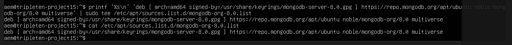

**Assessment: PASS (source configuration only).** The observed source file matches the MongoDB 8.0 Ubuntu 24.04/Noble official repository URL, suite, and component. Unlike MongoDB's multi-architecture example (`arch=amd64,arm64`), this VM deliberately uses `arch=amd64` because `dpkg --print-architecture` returned `amd64`. The signing key is scoped to this source by `signed-by`, not trusted for arbitrary APT repositories.

**At this checkpoint:** APT repository metadata had not yet been refreshed. This was subsequently verified in 15AR below. `mongodb-org` is not yet installed, and `mongod` has not been started, secured, or tested. The URL in a config file is not proof of repository availability or a successful GPG verification.

**Next checkpoint — 15AR (subsequently VERIFIED; see below):** Refresh APT's indexes using IPv4 and inspect output for signature verification errors, TLS errors, or skipped MongoDB index data. Read-only package metadata update: no installation. If that succeeds, inspect `apt-cache policy mongodb-org` before installing MongoDB.

```bash
sudo apt-get -o Acquire::ForceIPv4=true update
```

On success, expect MongoDB's `https://repo.mongodb.org/apt/ubuntu noble/mongodb-org/8.0` metadata to be fetched or hit without signature errors and the package lists read successfully. APT can sometimes retain old lists even when it emits `W:` warnings; a zero exit code alone is insufficient—review the actual output. Do not proceed with `mongodb-org` installation until this is verified.

Reference: https://www.mongodb.com/docs/v8.0/tutorial/install-mongodb-on-ubuntu/


### 15AR — Refresh APT indexes and verify MongoDB repository metadata (VERIFIED)

**Date:** October 31, 2026 (local; screenshot filename timestamp November 1, UTC)  
**Guest/terminal:** Ubuntu Bash (`aem@tripleten-project15`)  
**Goal:** Test access to the new `noble/mongodb-org/8.0` repository and APT's acceptance of its signed metadata; do not install or start MongoDB.

**Command executed:**

```bash
sudo apt-get -o Acquire::ForceIPv4=true update
```

**Observed output (relevant lines transcribed from user screenshot):**

```text
Hit:1 https://deb.nodesource.com/node_24.x nodistro InRelease
Get:4 https://repo.mongodb.org/apt/ubuntu noble/mongodb-org/8.0 InRelease [3,005 B]
Get:6 https://repo.mongodb.org/apt/ubuntu noble/mongodb-org/8.0/multiverse amd64 Packages [97.0 kB]
Fetched 4,304 kB in 3s (1,684 kB/s)
Reading package lists... Done
```

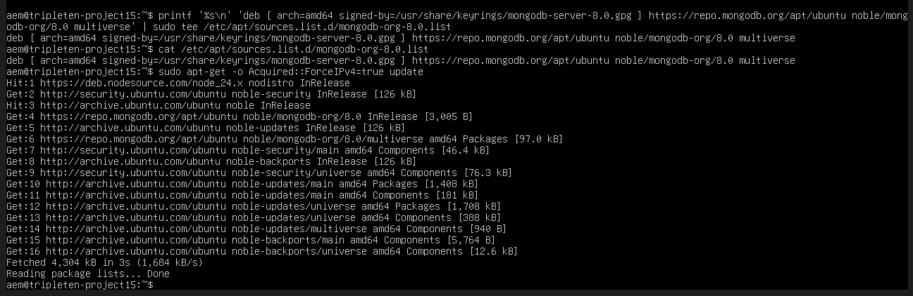

**Assessment: PASS.** The repository's signed metadata and `amd64` package index were fetched and the package list update completed with no visible `Err:`, GPG verification errors, TLS errors, or missing-index warnings. Normal APT signature enforcement applies to a source configured with `signed-by=/usr/share/keyrings/mongodb-server-8.0.gpg`; the output is evidence of a successful APT update, not an independent manual cryptographic signature audit. No packages were installed or upgraded by `apt-get update`.

**Security/limitations:** No MongoDB server has been installed, no database created, and no connection ports opened. Keep the intended VM-local-only database plan; avoid access to production Atlas credentials.

**Next checkpoint — 15AS (subsequently VERIFIED; see below):** Examine `apt-cache policy mongodb-org` to confirm the candidate package version and trusted origin, then simulate its installation with `apt-get -s install mongodb-org` to review dependencies, package counts, and removals before any installation. Both inspection commands are non-mutating; `apt-get -s` is not an actual install.

```bash
apt-cache policy mongodb-org
apt-get -s install mongodb-org
```

Do **not** run the real installation command until the simulation output has been reviewed, especially any `Remv` lines or unexpected changes. After installation, the database must be secured to guest loopback, verified through service/socket inspection, and tested under the guest firewall.

## D. Subsequent implementation stages — NOT YET PERFORMED

### 15AS — MongoDB package-policy inspection and installation dry-run (VERIFIED)

**Date:** October 31, 2026 (local; screenshot timestamp is November 1 UTC)  
**Guest:** Ubuntu 24.04 (`noble`), `amd64`  
**Goal:** Review APT's proposed installation *before* making any package changes. Package versions and dependencies reflect the repository indexes at the time of inspection and may differ when refreshed later.

**Commands executed (screenshotted):**

```bash
apt-cache policy mongodb-org
apt-get -s install mongodb-org
```

**Observed facts:**

- `apt-cache policy` listed MongoDB 8.0 releases from `https://repo.mongodb.org/apt/ubuntu noble/mongodb-org/8.0/multiverse amd64 Packages` (the top of the full policy listing is offscreen).
- The simulated installation selected `mongodb-org` **8.0.34**, alongside version 8.0.34 of the `mongodb-org-server`, `mongodb-org-database`, `mongodb-org-mongos`, `mongodb-org-shell`, `mongodb-org-tools`, and `mongodb-org-database-tools-extra` component packages.
- Additional dependency versions shown included `mongodb-mongosh` **2.14.1** and `mongodb-database-tools` **100.20.0**.
- APT summarized: **0 upgraded, 9 newly installed, 0 to remove, 0 not upgraded**.
- The shell returned to the normal prompt; no `Err:` or dependency resolution failure is visible.
- Because `apt-get -s` was run as a regular user, APT printed its expected simulation notice about disabled locking and root privileges being required for a real installation. This is not an installation failure.

```text
The following NEW packages will be installed:
  mongodb-database-tools mongodb-mongosh mongodb-org mongodb-org-database
  mongodb-org-database-tools-extra mongodb-org-mongos mongodb-org-server
  mongodb-org-shell mongodb-org-tools
0 upgraded, 9 newly installed, 0 to remove and 0 not upgraded.
Inst mongodb-org-server (8.0.34 mongodb:noble/mongodb-org/8.0 [amd64])
Inst mongodb-org (8.0.34 mongodb:noble/mongodb-org/8.0 [amd64])
```

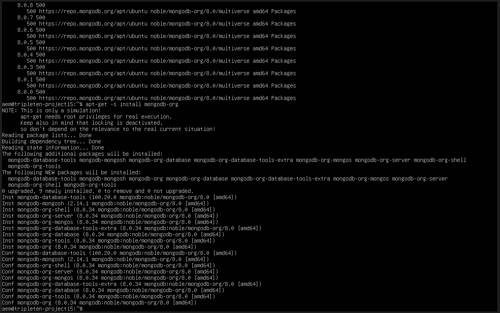

**Assessment: PASS (inspection only).** The simulation shows the expected MongoDB 8.0 Community components, and it does not plan to uninstall or replace existing packages. This confirms package *selection*, not the outcome of a real installation. MongoDB **has not yet been installed or started** at this checkpoint. Previous UFW and VM-local-only network restrictions remain unchanged. This lab database is separate from local Windows `wtwr_db` and production Atlas `wtwr_render`.

**Next checkpoint — 15AS.1 (SUBSEQUENTLY INSTALLED AND VERIFIED; see below):** Install the reviewed packages using the official `mongodb-org` metapackage, then inspect actual package status **before** starting or enabling the server:

```bash
sudo apt-get -o Acquire::ForceIPv4=true install -y mongodb-org
mongod --version | head -n 2
dpkg -l mongodb-org mongodb-org-server mongodb-mongosh | grep '^ii'
```

The installation may run normal package-maintainer scripts and create files/directories, but it should **not** be taken as evidence that MongoDB is listening only on loopback until `/etc/mongod.conf` and the listening sockets are independently inspected. Do not add a UFW inbound rule for port 27017 or put Atlas credentials on this VM. Official reference: https://www.mongodb.com/docs/v8.0/tutorial/install-mongodb-on-ubuntu/

### 15AM (continued) — Isolated VM database approach (historical selection and plan)

Guest firewall default policies, root disk, RAM and MongoDB executable absence are now verified above. **AVX and the `noble` Ubuntu release have been verified; the tool paths are present. A mistyped architecture command was corrected and `amd64` verified on follow-up.** Separately, effective SSH configuration, service ports, host/LAN isolation testing and Secure Boot enforcement remain pending.

#### Database strategy — decision and scope (not yet implemented)

Express `app.js` attempts a MongoDB connection **before** starting its HTTP listener. `mongodb-memory-server` is only for tests and must not be used as the persistent deployed database. Two candidate lab strategies are:

1. **Local VM MongoDB:** isolated `wtwr_vm_lab` database, bound to guest loopback (`127.0.0.1`); no inbound MongoDB ports, no live cloud credentials. Additional installation, memory and maintenance cost, but useful for practicing local service dependency and restore.
2. **Atlas lab database:** a new database-scoped user with permissions only on `wtwr_vm_lab`, plus carefully reviewed egress/network restrictions. Requires Atlas IP access and outbound connection controls; public cloud production data must remain separate.

**Current lab direction:** Use the distinct MongoDB Community server now installed inside the Ubuntu guest, solely for VM administration, service-recovery, and backup/restore exercises. Installation was verified in 15AS.1 and the loopback-only **configured** bind was verified in 15AS.2; **actual listening socket**, service startup, and isolated lab database are **still pending**. It is not a replica, backup or failover for Atlas; cloud production credentials/data stay out of the VM. Revisit this choice only if the VM requirements or resource limits demand it. No active replication/failover should be claimed.

### 15AS.1 — Install MongoDB Community Server 8.0.34 (VERIFIED)

**Date:** October 31, 2026 local (terminal screenshot named November 1, UTC)  
**Guest/terminal:** Ubuntu Bash (`aem@tripleten-project15`)  
**Goal:** Execute the already reviewed APT installation; verify the installed server binary and current service state, **without starting or enabling** MongoDB or opening firewall ports.

**Commands actually executed:**

```bash
sudo apt-get -o Acquire::ForceIPv4=true install -y mongodb-org
mongod --version | head -n 2
dpkg -1 mongodb-org mongodb-org-server mongodb-mongosh | grep '^ii'  # ACTUAL TYPO: digit 1
systemctl is-active mongod
```

**Observed terminal evidence (relevant excerpt, transcribed from user screenshot):**

```text
Setting up mongodb-mongosh (2.14.1) ...
Setting up mongodb-org-server (8.0.34) ...
info: Adding system user 'mongodb' (UID 110) ...
info: Adding group 'mongodb' (GID 110) ...
Setting up mongodb-org-shell (8.0.34) ...
Setting up mongodb-database-tools (100.20.0) ...
Setting up mongodb-org-mongos (8.0.34) ...
Setting up mongodb-org-database (8.0.34) ...
Setting up mongodb-org-tools (8.0.34) ...
Setting up mongodb-org (8.0.34) ...
Running kernel seems to be up-to-date.
No services need to be restarted.

db version v8.0.34
Build Info: {

dpkg: error: unknown option -1

inactive
```

The real APT installer finished its configuration and returned to the Bash prompt without a visible installation error. The MongoDB server executable reports `v8.0.34`. The `dpkg` verification was **not completed** because `-1` (digit one) was used instead of the correct `-l` (lowercase L); this is a command typo, not evidence of broken packages. A package-state check is therefore still pending. `systemctl is-active mongod` returned `inactive`, which is expected because the service was deliberately not started.

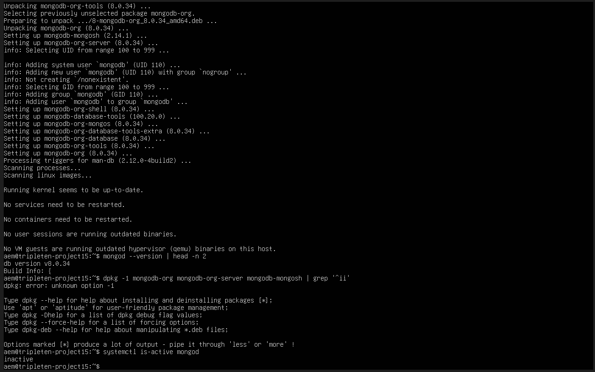

**Assessment: PASS for package installation and server binary version; INCOMPLETE for package status and network configuration.** This does **not** demonstrate that the service is running, listening only on loopback, secured by authentication, or writing an isolated database. No UFW inbound MongoDB rule was added. Atlas and Windows database content were not involved. MongoDB's official packaging installs `/etc/mongod.conf`, data directory `/var/lib/mongodb` and log directory `/var/log/mongodb`; the on-disk contents and permissions have **not yet been checked** on this VM.

**Next checkpoint — 15AS.2 (COMPLETED; see below):** Correctly inspect installed packages and **read** `/etc/mongod.conf` before any service start:

```bash
dpkg -l mongodb-org mongodb-org-server mongodb-mongosh | grep '^ii'
sudo sed -n '1,160p' /etc/mongod.conf
```

Expected package status is `ii` for the selected packages; verify that `net.bindIp` is explicitly `127.0.0.1` and `net.port` is `27017`. If configuration is missing or binds to `0.0.0.0`, **stop without starting the service** and correct it deliberately. Do not expose TCP 27017 through UFW, VirtualBox, the host LAN, or the router. Only after verifying loopback binding should the service be started and the actual listening socket tested (`ss`).

Official installation and default-bind reference: https://www.mongodb.com/docs/v8.0/tutorial/install-mongodb-on-ubuntu/

### 15AS.2 — Installed packages and MongoDB loopback configuration (VERIFIED)

**Date:** October 31, 2026 local / November 1 screenshot file label  
**Host/terminal:** Ubuntu Bash (`aem@tripleten-project15`)  
**Goal:** Confirm installed MongoDB packages and inspect the actual configuration **before** any service start.

**Commands actually run (package checks split across two commands in the screenshot):**

```bash
dpkg -l mongodb-org mongodb-mongosh | grep '^ii'
dpkg -l mongodb-org-server
sudo sed -n '1,160p' /etc/mongod.conf
```

**Observed package results (excerpt):**

```text
ii  mongodb-mongosh       2.14.1  amd64
ii  mongodb-org           8.0.34  amd64
ii  mongodb-org-server    8.0.34  amd64
```

The leading `ii` means each package is selected for installation and currently installed. This resolves the earlier `dpkg -1` verification typo.

**Observed `/etc/mongod.conf` settings (transcribed):**

```yaml
storage:
  dbPath: /var/lib/mongodb
systemLog:
  destination: file
  logAppend: true
  path: /var/log/mongodb/mongod.log
net:
  port: 27017
  bindIp: 127.0.0.1
processManagement:
  timeZoneInfo: /usr/share/zoneinfo
#security:
```

**Assessment: PASS for installed-package state and configured local-only binding.** `net.bindIp: 127.0.0.1` directs MongoDB to listen only on the guest loopback interface, not on VirtualBox NAT (`10.0.2.x`) or the home LAN. TCP 27017 has **not** been opened in UFW or forwarded through VirtualBox. The output does *not* yet verify that the daemon actually starts or that the active listening socket matches the configuration. No database writes were performed.

**Important security limitation:** `#security:` is commented out in the package's default configuration; this screenshot provides **no evidence of MongoDB authorization being enabled**. In a loopback-only, nonpublic lab, that may be acceptable temporarily for initial service validation, but any local process or user with access to the guest loopback could potentially access the service. Before using it for anything other than disposable lab data, decide whether to enable authorization and provision a least-privilege application account. Do not expose this unauthenticated service on any interface other than the VM's own loopback.

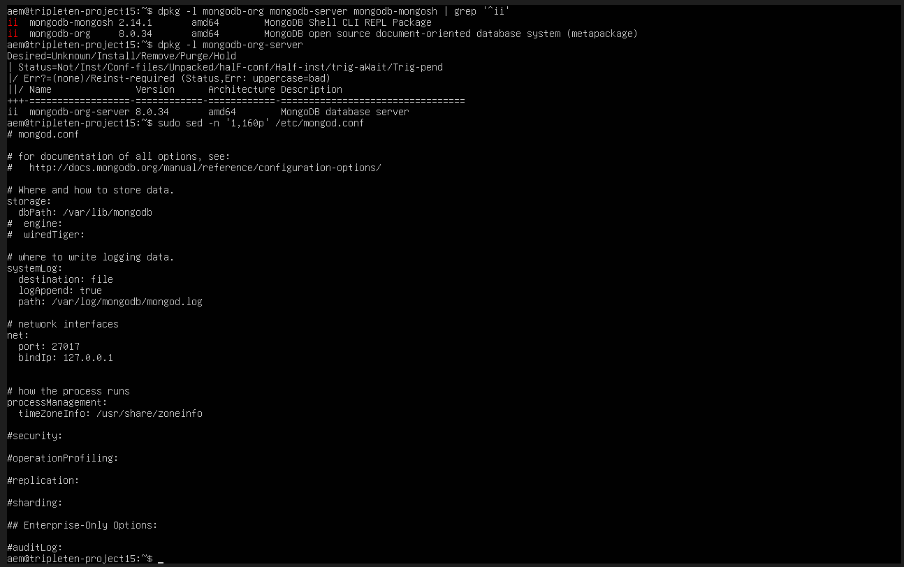

**Next checkpoint — 15AS.3 (COMPLETED; see following section):** Start the MongoDB service (without enabling boot persistence yet), verify `systemctl` service state, verify with `ss` that the process listens **only** on `127.0.0.1:27017`, and issue a local `ping` through `mongosh`. If the bind differs or startup fails, stop the service and inspect logs before continuing. No UFW changes or port forwards.

```bash
sudo systemctl start mongod
systemctl is-active mongod
sudo ss -lntp | grep ':27017'
mongosh --quiet --eval 'db.adminCommand({ping: 1}).ok'
```

Expected results `active`, `127.0.0.1:27017`, and `1` were subsequently **observed**; see checkpoint 15AS.3 below. No automatic startup has been enabled yet.

### 15AS.3 — Start service; verify loopback socket and local ping (VERIFIED)

**Date:** October 31, 2026 local (screenshot filename begins November 1, UTC)  
**Guest:** `TripleTen-Project15` Ubuntu 24.04 LTS  
**Goal:** Start the freshly installed MongoDB service **without enabling boot persistence**, confirm its running listener is guest loopback only, and check that the database accepts a local ping.

**Commands actually executed:**

```bash
sudo systemctl start mongod
systemctl is-active mongod
sudo ss -lntp | grep ':27017'
mongosh --quiet --eval 'db.adminCommand({ping: 1}).ok'
```

**Actual observed output (excerpt):**

```text
active
LISTEN 0 4096 127.0.0.1:27017 0.0.0.0:* users:(("mongod",pid=2555,fd=9))
1
```

**Assessment: PASS.** Systemd reports MongoDB active; `ss` confirms its **local listening endpoint** is `127.0.0.1:27017`, not `0.0.0.0:27017` or `10.0.2.15:27017`; and `mongosh` reports a successful ping (`1`). The `0.0.0.0:*` shown by `ss` is in the **peer-address** field, not the bound listening address. No VirtualBox port-forwarding, UFW allow rule, Atlas access, or database document write was involved.

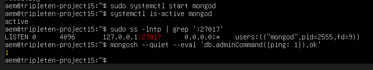

**Scope and limitations:** This validates listener binding and an unauthenticated local health check. It does **not** prove the guest is fully isolated from the Windows host or home network; the guest may still initiate connections allowed by its firewall, and the Windows host may have other exposure paths. `security.authorization` remains disabled in the inspected default config; other guest-local processes can access MongoDB, so use only disposable lab data until guest auth and service permissions are reviewed. Boot-time persistence (`systemctl enable mongod`) has **not** been verified or enabled. A named `wtwr_vm_lab` database, application MONGODB_URI, PM2, and Nginx remain pending.

**Next checkpoint (15AS.4, PARTIAL — see below):** Verify `.env.local` is ignored and check whether the VM already defines `MONGODB_URI` without displaying secrets. Both checks have now been performed; the URI remains to be set and verified. Do not connect the VM to Atlas or Windows; use only disposable data until local authentication decisions are complete.

### 15AS.4 — Inspect VM `.env.local` and Git ignore state (PARTIAL VERIFIED)

**Date:** October 31, 2026 local (screenshot file uses November 1 UTC)  
**Terminal:** Ubuntu Bash (`aem@tripleten-project15`) in `~/projects/se_project_express`  
**Goal:** Confirm whether a guest-specific MongoDB URI already exists, without displaying the JWT signing secret or other environment values, and ensure the environment file is excluded from Git.

**Commands executed:**

```bash
cd ~/projects/se_project_express
if grep -q '^MONGODB_URI=' .env.local; then
  echo "MONGODB_URI is already configured"
else
  echo "MONGODB_URI is not configured"
fi
git check-ignore .env.local
```

**Actual output:**

```text
MONGODB_URI is not configured
.env.local
```

**Assessment: PASS for secret-safe presence and ignore checks; configuration PENDING.** The file exists (no `grep` error was shown) and Git ignores it. No `MONGODB_URI=` line is present. This is consistent with the Express project's previous fallback to a local default `wtwr_db`, but **do not use the fallback** for this isolated lab: the intended database is `wtwr_vm_lab`.


**Next manual action (COMPLETED; 15AS.5 below):** Append `MONGODB_URI=mongodb://127.0.0.1:27017/wtwr_vm_lab` to the VM's `.env.local` without altering its existing `JWT_SECRET`. Confirm the setting's destination and file permission without printing credentials; then run a read-only Node/Mongoose connectivity test before starting Express. Use disposable data; the default loopback-only MongoDB currently has no authorization enabled. No modifications to Atlas, Windows MongoDB, UFW or the Git repository are needed.

### 15AS.5 — Set local MongoDB target; check secret-file mode (VERIFIED, user-reported)

**Date:** October 31, 2026 (Pacific)  
**Terminal:** Ubuntu Bash in `~/projects/se_project_express`  
**Goal:** Give Express an explicit **guest-local** MongoDB URI; keep the separate existing JWT secret and the file out of source control.

**Commands provided for and confirmed completed by the user:**

```bash
printf '\n%s\n' 'MONGODB_URI=mongodb://127.0.0.1:27017/wtwr_vm_lab' >> .env.local

grep -qFx 'MONGODB_URI=mongodb://127.0.0.1:27017/wtwr_vm_lab' .env.local && echo 'VM MongoDB target: verified'
stat -c 'Permissions: %a' .env.local
git status --short --branch
```

**Observed results:** The user reported `verified`, `600`, and `origin/main`, referring respectively to the exact-match URI check, file permission, and Git branch tracking. The complete terminal lines or a screenshot were **not** supplied for this checkpoint.

**Assessment: PASS for the reported configuration checks; connection NOT YET TESTED.** The connection string is the VM's own `127.0.0.1:27017/wtwr_vm_lab`, not Windows, not public Atlas. File mode `600` restricts ordinary non-root read access to the owner. `.env.local` was previously verified ignored by Git. The user reported the checkout remains on `main` tracking `origin/main` (no new changes reported). This is a configuration verification, **not** proof that Node/Mongoose can connect or that MongoDB created a persistent `wtwr_vm_lab` database. As MongoDB uses lazy database creation, a read-only ping does not create this database.

**Next test (COMPLETED, 15AS.6 below):** Node/Mongoose connected to the guest-local database with the `.env.local` URI. The final successful command printed the database name, but did not separately issue `db.adminCommand({ping:1})`. No write was performed.

### 15AS.6 — Mongoose connection from the app project (VERIFIED)

**Date:** October 31, 2026 Pacific (November 1 UTC)  
**Terminal:** Ubuntu Bash, `aem@tripleten-project15`, directory `~/projects/se_project_express`  
**Goal:** Confirm that the backend's installed Mongoose driver can connect to **Ubuntu's own** MongoDB database using the ignored `.env.local`, with no Atlas or Windows database traffic and without writing records.

**Initial test:** A lengthy multiline `node -e '…'` command was manually entered and failed at JavaScript parsing with `SyntaxError: Unexpected identifier 'disconnect'`. Since parsing failed before execution, **this was not a failed database connection**. The incident demonstrated that lengthy manually typed code is error-prone; use simple, copyable **single-line commands** for subsequent interactive guest checkpoints.

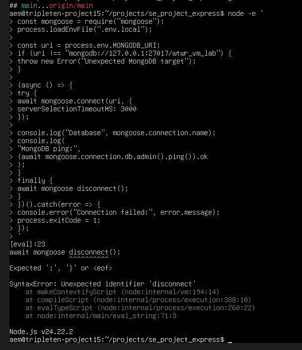

**Successful command, executed next:**

```bash
node --env-file=.env.local -e 'const m=require("mongoose");m.connect(process.env.MONGODB_URI).then(()=>{console.log("Connected:",m.connection.name);return m.disconnect()}).catch(e=>console.log(e.message))'
```

**User-observed result:**

```text
Connected: wtwr_vm_lab
```

**Assessment: PASS.** Mongoose successfully established a connection using `MONGODB_URI`, reported the exact target database `wtwr_vm_lab`, then the test code requested disconnection. No application listener or PM2 process was started, no documents were inserted, and no other database was accessed by the test. An earlier `mongosh` ping separately returned `1` at checkpoint 15AS.3. The successful Mongoose one-liner did **not** separately issue a ping command or verify durable database writes.

**Security scope:** This uses local `127.0.0.1:27017` per the previously verified `.env.local` setting. MongoDB's default authorization is still disabled, so use only disposable guest data pending hardening. Do not expose the guest MongoDB listener or copy production credentials into the VM.

**Next checkpoint:** Inspect the current PM2 installation status and npm registry/version; then install a documented, pinned PM2 release. Start Express under the unprivileged `aem` account, confirm the database connection and local HTTP endpoints, and only then consider boot persistence and Nginx. Do not modify the public Render service or Atlas.

### 15AT.0 — PM2 preinstallation checks (VERIFIED, user-reported)

**Date:** October 31, 2026 (Pacific)  
**Terminal:** Ubuntu Bash, `aem@tripleten-project15`  
**Goal:** Determine whether PM2 exists and identify the current npm-published version before choosing a reproducible installation command.

**Commands performed:**

```bash
command -v pm2 || echo "PM2 not installed"
npm view pm2 version
```

**User-reported outputs:**

```text
PM2 not installed
7.1.1
```

**Assessment: PASS for preinstallation discovery, NOT YET INSTALLED.** The `pm2` executable was not on the user's PATH. The npm registry reported version **7.1.1** as the current PM2 package release. This was a read-only check; the current Git checkout, local MongoDB connection and running application state were not changed. Independently cross-checked against the public npm package listing (https://www.npmjs.com/package/pm2) and PM2's quick-start installation reference (https://pm2.keymetrics.io/docs/usage/quick-start/).

**Next command:** Completed in 15AT.1 below. PM2 is installed globally, but its daemon is running as unprivileged `aem`; we have not yet started an application, configured boot persistence, opened an HTTP port, or modified UFW.

### 15AT.1 — PM2 global installation and daemon bootstrap (VERIFIED)

**Date:** October 31, 2026 Pacific (November 1 UTC)  
**Terminal:** Ubuntu Bash, `aem@tripleten-project15`, project folder `~/projects/se_project_express`  
**Goal:** Install the reviewed PM2 7.1.1 CLI globally, then confirm it is available under the unprivileged user's session.

**Commands provided and executed:**

```bash
sudo npm install -g pm2@7.1.1
pm2 --version
command -v pm2
```

**Observed results (user screenshot plus direct report):** npm completed the installation; npm printed an optional newer npm version notice. On first `pm2 --version`, PM2 displayed its welcome banner and stated:

```text
[PM2] Spawning PM2 daemon with pm2_home=/home/aem/.pm2
[PM2] PM2 Successfully daemonized
7.1.1
```

The user separately reported:

```text
command -v pm2: /usr/bin/pm2
```

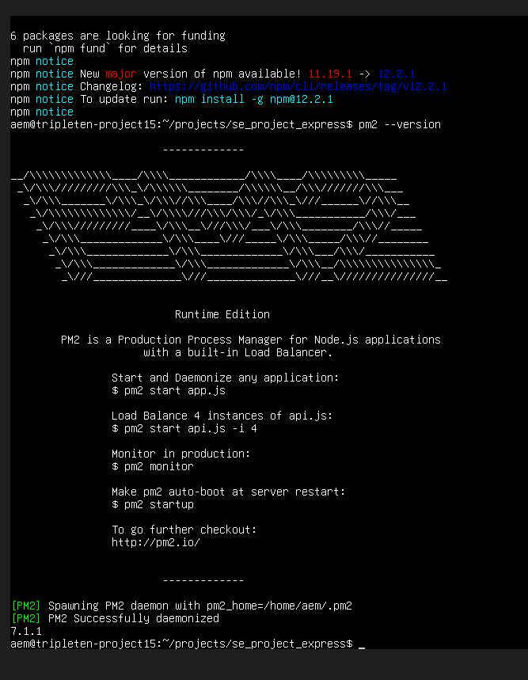

**Assessment: PASS for PM2 installation and first daemon startup.** The executable is system-wide (`/usr/bin/pm2`), but the observed PM2 home path is inside `aem`'s home directory. This is evidence of the background daemon launched in the user's context; it does **not** prove Express is running, HTTP is accessible, or processes will survive reboot. No upgrade to npm 12 was performed, and no VM firewall/NAT changes were reported.

**Next checkpoint 15AT.2:** Executed and verified below. No systemd boot startup or firewall/NAT changes have been made.

### 15AT.2 — Start Express under PM2 as an unprivileged user (VERIFIED)

**Date:** October 31, 2026 Pacific (November 1 UTC)  
**Host/terminal:** Ubuntu Bash, `aem@tripleten-project15`, in `~/projects/se_project_express`  
**Goal:** Launch Express under PM2 without root privileges, confirm process state, verify that Express can connect to the guest-local MongoDB database and starts its HTTP listener.

**User-executed commands:**

```bash
pm2 start app.js --name wtwr-vm-api --time
pm2 list
pm2 logs wtwr-vm-api --lines 15 --nostream
```

The screenshot also shows an additional interactive `pm2 logs wtwr-vm-api` followed by Ctrl+C to end log tailing. **Ctrl+C ended the log viewer, not the PM2-managed application.**

**Observed results, excerpts from screenshot:**

```text
[PM2] Starting /home/aem/projects/se_project_express/app.js in fork_mode (1 instance)
[PM2] Done.
name: wtwr-vm-api; status: online; mode: fork; user: aem; restarts: 0
2026-11-01T00:57:10: MongoDB connected
2026-11-01T00:57:10: Server listening on port 3001
```

The process table showed initial PID `3411`; transient PID and memory measurements should **not** be assumed permanent. PM2's reported status was `online`, with the project version `1.0.0`. PM2 placed the logs under `/home/aem/.pm2/logs/`.

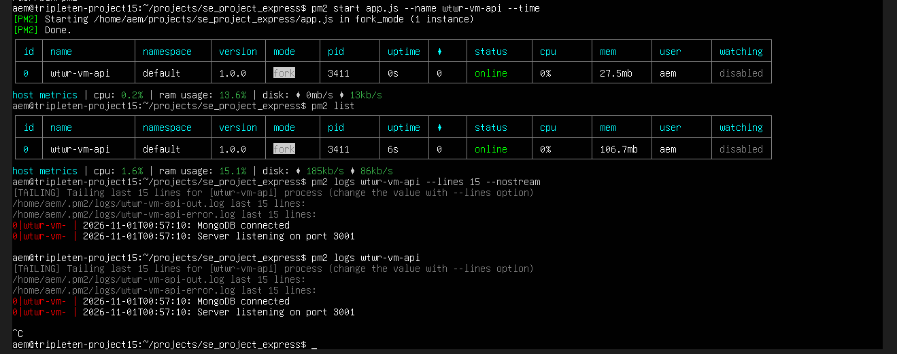

**Assessment: PASS for supervised process launch and backend startup.** The app's startup code connects Mongoose before listening; the `MongoDB connected` line, paired with earlier explicit `MONGODB_URI` inspection and successful Mongoose test, supports that Express is connected to the guest-local `wtwr_vm_lab` database. The startup log is **not** a complete HTTP or persistence test. The `online` status does not demonstrate that the process recovers after a crash or machine reboot.

**Security notes:** Run PM2 as `aem`, not root. The guest MongoDB listener is loopback-only and has authorization disabled pending lab hardening. The Express source currently uses `app.listen(PORT)` without an explicit host argument; its actual interface binding has **not** yet been inspected. We must check listening sockets and UFW before offering host access. No additional VirtualBox NAT port forward or LAN exposure was authorized by this checkpoint.

**Next checkpoint 15AT.3 (PENDING):** Run read-only guest-local `curl` checks against `/` and `/items`; examine the Express port 3001 listener with `ss`. If the server listens on all interfaces, preserve existing deny-inbound firewall policy and evaluate loopback binding or host-enforced access controls **before** Nginx/host-browser access. Do not configure `pm2 startup`, `pm2 save`, open ports or change source code yet. Then continue with Nginx and reboot/recovery tests.


### 15AT.3–15AT.8 — Restart recovery after changing household networks (PARTIALLY VERIFIED)

**Date:** November 12, 2026 Pacific (November 13 UTC in logs/screenshots).
**Host:** Ubuntu `aem@tripleten-project15`, working directory `~/projects/se_project_express`.
**Intent:** Establish current state on a new physical network, diagnose unavailable backend, restore database and process, and prepare to test unattended boot recovery. The user reported no intentional configuration changes while exploring the shell.

#### 15AT.3 — Guest NAT address and initial HTTP failure (VERIFIED)

```bash
ip -4 addr show enp0s3
curl -i --max-time 5 http://127.0.0.1:3000
curl -i --max-time 5 http://127.0.0.1:3001/
```

**Observed:** Interface `enp0s3` was `UP` with `inet 10.0.2.15/24`; both HTTP requests failed with `curl: (7) Failed to connect ... after 0 ms: Couldn't connect to server`. Initial test was *before* service restoration, so do not mistake this failure for the post-recovery HTTP outcome.

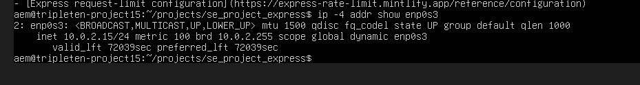

#### 15AT.4 — PM2 empty after fresh boot (VERIFIED)

```bash
pm2 list
```

**Observed:** `[PM2] PM2 Successfully daemonized` under `/home/aem/.pm2`, followed by a process table with **no registered applications**. Prior `wtwr-vm-api` had not been configured for automatic recovery. No evidence of deleted application files.

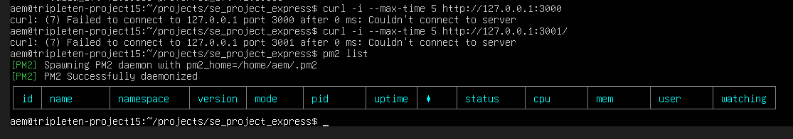

#### 15AT.5–15AT.7 — MongoDB service restored and enabled at boot (VERIFIED CONFIGURATION, REBOOT TEST PENDING)

```bash
systemctl is-active mongod; systemctl is-enabled mongod
sudo systemctl start mongod
systemctl is-active mongod
sudo systemctl enable mongod
systemctl is-enabled mongod
```

**Observed:** Initial `inactive`, `disabled`. After manual start: `active`. `enable` created a symlink at `/etc/systemd/system/multi-user.target.wants/mongod.service` to `/usr/lib/systemd/system/mongod.service`. Final `is-enabled`: `enabled` (confirmed by user). **This verifies the startup configuration, not yet its successful operation after another reboot.**

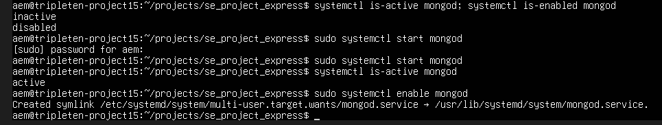

#### 15AT.8 — Express restored under PM2 (VERIFIED PROCESS START; HTTP VERIFIED SUBSEQUENTLY AT 15AT.9)

```bash
pm2 start app.js --name wtwr-vm-api --time
pm2 list
pm2 logs wtwr-vm-api --lines 10 --nostream
```

**Observed:** `wtwr-vm-api` `online`, fork mode, owned by `aem`, PM2 restart count 0, PID 4633 (transient). Fresh application log messages include `2026-11-13T04:47:47: MongoDB connected` and `2026-11-13T04:47:47: Server listening on port 3001`. Original `2026-11-01T00:57:10` startup entries remained in the same log file. The messages are in the error-stream log because application startup uses `console.warn`; they do not alone indicate an error.

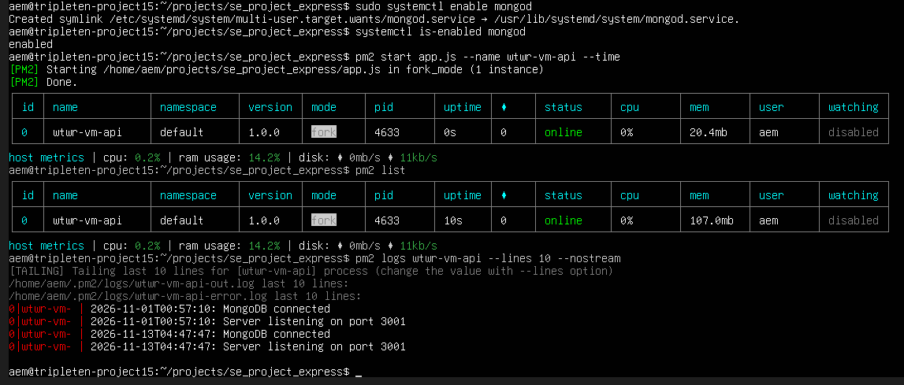

**Assessment:** Network address survived the location change, MongoDB is now configured for boot startup and Express has been manually restored. **Still pending at the time of 15AT.8:** post-recovery root `curl` (subsequently PASSED at 15AT.9), authenticated/unauthenticated endpoints, `ss` socket binding inspection, PM2 process save/startup, and successful controlled reboot verification. No Nginx, firewall rule, VirtualBox port-forward or other network configuration changes were made.

#### 15AT.9 — Express root HTTP smoke test (VERIFIED PASS)

**Date:** November 12, 2026 Pacific (response header dated Friday, November 13, 2026 04:51:44 GMT).  
**Host/terminal:** Ubuntu guest, user `aem`, working directory `~/projects/se_project_express`.

```bash
curl -i --max-time 5 http://127.0.0.1:3001/
```

**Observed:** `HTTP/1.1 200 OK`; JSON `Content-Type: application/json; charset=utf-8`; response body `{"status":"ok"}`. Security headers were present (including `Content-Security-Policy` and `X-Frame-Options`). Port 3001 was responsive through Ubuntu's loopback address after PM2 and MongoDB were manually restored.

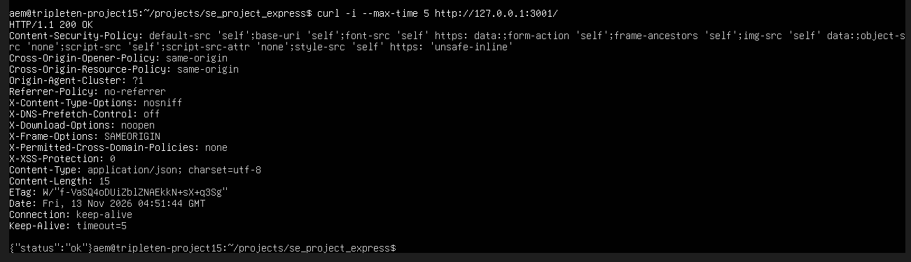

**Assessment:** PASS for unauthenticated local API health/root endpoint; **not** a complete `/items`, authentication, socket binding, PM2 restart/reboot or Nginx verification. No new firewall rules, NAT forwardings, configuration files or external service changes were made.

#### 15AT.10 — Express `/items` HTTP smoke test (VERIFIED PASS)

**Date:** November 12, 2026 Pacific (HTTP response's GMT date header: November 13, 2026).  
**Host/terminal:** Ubuntu guest, user `aem`, working directory `~/projects/se_project_express`.

```bash
curl -i --max-time 5 http://127.0.0.1:3001/items
```

**Observed:** `HTTP/1.1 200 OK`, `Content-Type: application/json; charset=utf-8`, response body `[]`, and security headers. The empty array is consistent with our isolated `wtwr_vm_lab` database containing no clothing items. The earlier PM2 startup logs independently show `MongoDB connected`. No data was created or modified.

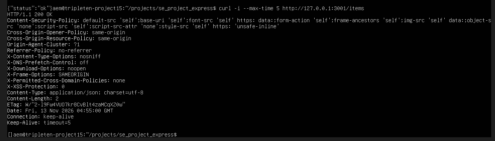

**Assessment:** PASS for guest-local unauthenticated `GET /items`; this does **not** yet establish the socket's binding interface, PM2 startup persistence, authenticated access, Nginx, or successful recovery after another reboot.

**Next checkpoint (PENDING):**

```bash
sudo ss -lntp | grep ':3001'
```

Determine whether Express is bound to loopback or all guest interfaces. Do not alter UFW or VirtualBox NAT forwards without a separate review. Then configure PM2 process save/startup only after the listener is understood.

### 15AU — Nginx reverse proxy and React static assets (planned)

Install Nginx from Ubuntu's package repository after inspecting planned changes; bind lab access to loopback; proxy to local Express and optionally serve a Vite production build. Examine `Host`, forwarded-IP and rate-limiter trust boundaries before relying on reverse proxy headers. Do not enable router forwarding or public ports. For host-browser access, consider SSH local port forwarding rather than opening network adapters.

### 15AV — Repeatable verification and recovery (planned)

Test local `/` and `/items` paths with isolated sample data, login and ownership checks, PM2 process restart/reboot persistence, Nginx config reload, reverse-proxy rate limits, database outage/recovery, firewall/SSH persistence and recovery from snapshot or backup. Record each actual outcome, including failures. A snapshot is not an independent backup. Evaluate any Sprint 15 VM-specific rubric gaps separately from the approved public Render alternative.

## E. Checkpoint record template

Copy this block for each step **after performing it**:

```markdown
### Checkpoint 15XX — Short description
**Date:** YYYY-MM-DD  
**Host/terminal:** Windows PowerShell / Ubuntu Bash  
**Goal:** ...  
**Command or UI action:** (redacted and reproducible)  
**Observed output:** (actual, abbreviated only when clearly marked)  
**Assessment:** PASS / FAIL / BLOCKED / NOT VERIFIED  
**Security considerations:** ...  
**Next action / rollback:** ...
```

## F. Remaining high-priority security items

- The database password for `wtwr_render_app` was exposed in a previous screenshot/chat. The user previously declined rotation; it remains an unresolved security risk. Never include it in documents. Do **not** treat current cloud deployment as fully hardened.
- Confirm trusted proxy / rate-limit configuration on Render and the VM independently.
- Inspect and test recoverable cloud backups; Atlas replication does not replace backup.
- Validate VM host-side isolation, Secure Boot enforcement, production negative tests, and cloud service restart behavior before marking all deployment work completed.


### 15AT.11 — Express socket listener inspection (VERIFIED)

**Date:** November 12, 2026 Pacific (guest timestamp showed November 13 UTC). **User:** `aem`; cwd `~/projects/se_project_express`.

```bash
sudo ss -lntp | grep ':3001'
```

**Observed:** `LISTEN 0 511 *:3001 *:* users:(("node /home/aem/...",pid=4633,fd=26))` (truncated here to avoid assuming a complete executable path). The `*:3001` local socket value is a **wildcard listener**, meaning Express is not limited to loopback. This does **not** establish that connections reach the VM from the LAN or internet: VirtualBox NAT and the guest firewall are separate controls. The earlier NAT setup had no forward to 3001 and UFW default-denied inbound traffic. External reachability was not retested at this checkpoint. `*:*` in the peer column is standard for a listening socket, not an outbound connection.

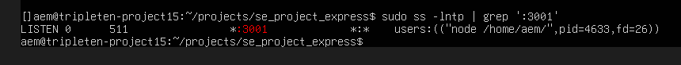

**Security follow-up (PENDING):** Keep the lab private; consider making `HOST` configurable in app startup so Ubuntu listens at `127.0.0.1` and Render continues listening on the platform-provided interface (`0.0.0.0`). Do not hardcode loopback globally in `app.js` without testing the cloud deployment; do not add public forwards or UFW allow 3001.

### 15AT.12 — Node.js health-check draft (NOT ADOPTED OR EXECUTED)

User requested an automated verification flow written in JavaScript for TripleTen coursework, rather than Python. A standalone read-only candidate is included as [`../../scripts/vm-healthcheck.js`](scripts/vm-healthcheck.js). It uses Node built-ins (`child_process`, global `fetch`), and checks:

- MongoDB `systemctl is-active` and `is-enabled`.
- PM2's `wtwr-vm-api` online status (`pm2 jlist` as normal user).
- Local port 3001 socket and a warning for wildcard interface binding.
- `GET /` -> JSON status `ok`; `GET /items` -> HTTP 200 and JSON array.

**Important:** The included script is an earlier assistant-generated draft, retained unchanged for reference. The user chose to develop the final health checker collaboratively, step by step. It has **not** been installed, approved for operation, executed on the Ubuntu VM, or scheduled at boot. Do not treat it as a completed deployment checkpoint. Startup persistence still requires separate PM2 save/startup configuration, with testing after reboot.
